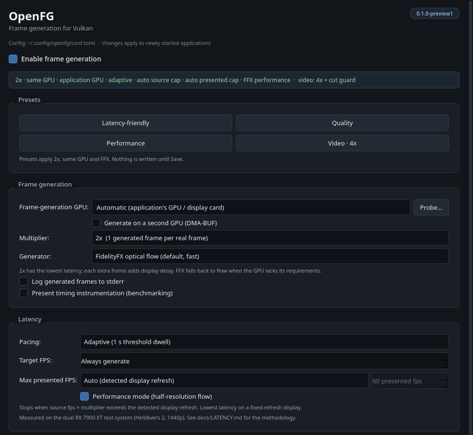

# OpenFG

[](https://github.com/sky-is-green/openfg/actions/workflows/build.yml)
[](LICENSE)

OpenFG is open frame generation for Linux: an implicit Vulkan layer that
inserts 2x, 3x or 4x interpolated frames into any Vulkan application — games,
emulators and Vulkan video players — without modifying the app.

The default backend is AMD's MIT-licensed FidelityFX Optical Flow, with an
automatic fallback to OpenFG's original optical-flow pipeline. A static-UI
mask keeps HUD text sharp on generated frames.

> No Lossless Scaling assets, no `lsfg-vk.dll`, and no lsfg-vk source code are
> used here. The vendored FidelityFX shaders and their notices are under
> `src/openfg/shaders/ffx/`; see [THIRD_PARTY.md](THIRD_PARTY.md).

**Status:** `v0.1.0-preview1` — core feature-complete, real-game tested on
RDNA3. Broader GPU validation and distribution packages are still open.
Read the [technical white paper](docs/WHITEPAPER.md) for the full design.

## Features

| Feature | Support |
|---|---|
| **Frame insertion** | 2x, 3x and 4x |
| **Backends** | FidelityFX optical flow (default), original OpenFG flow, linear blend, hold, timing-only off |
| **GPUs** | Same-GPU (OpaqueFd) and same-vendor cross-GPU (DMA-BUF) |
| **Pacing** | Adaptive or capped source; target FPS; refresh-aware presented-frame cap |
| **Display** | 8-bit and 10-bit/HDR half-float swapchains; multiple swapchains per device |
| **Content** | Process include/exclude, native and Wine/Proton names, video profile with scene-cut guard |
| **HUD** | Static-UI mask removes doubled HUD text on generated frames |
| **Controls** | TOML config, `OPENFG_*` overrides, CLI and Qt control panel |
| **Tooling** | `fg-lab` harness, synthetic benchmarks, HUD regression test, GPU probe |

## Quick start

Build and install for the current user:

```sh
git clone https://github.com/sky-is-green/openfg
cd openfg
scripts/install-local.sh        # builds and installs under ~/.local
scripts/install-gui.sh          # optional; needs PySide6

openfg-cli init                 # writes ~/.config/openfg/conf.toml if missing
$EDITOR ~/.config/openfg/conf.toml
openfg-cli validate
openfg-gpu-probe
```

A minimal config:

```toml
[openfg]
enabled = true
generator = "ffx"
gpu = "auto"
cross_gpu = false
multiplier = 2
```

Then launch the game. The layer is installed implicitly, so every Vulkan
process loads it; the config decides whether it is active. Use
`DISABLE_OPENFG=1` to bypass it for one process.

## Control panel

`openfg-gui` edits the same file. It includes presets, a GPU capability probe,
process/video profiles and a live summary of the effective mode.



Presets:

- **Latency-friendly** — 2x, capped source, FFX.
- **Quality** — 2x, generate on every frame, full-resolution FFX.
- **Performance** — 2x, half-resolution flow, ~50% cheaper at 1440p.
- **Video · 4x** — 4x for a Vulkan player, adds `mpv` and the cut guard.

Nothing is written until **Save**. Changes apply to applications started
afterwards.

## How it works

1. The layer hooks instance/device/swapchain/present.
2. Two real frames are copied to the compute backend, which estimates optical
   flow and renders the intermediate frame at `t=0.5` (`0.25/0.5/0.75` for 4x).
3. Interpolated frames are presented before the current real frame. Static HUD
   text is detected and copied from an unwarped source, so it cannot double.
4. Anything unsupported falls back to passthrough: separate present queue
   families, no free swapchain image, or missing Vulkan features.

## Configuration

The layer reads `$XDG_CONFIG_HOME/openfg/conf.toml`, falling back to
`~/.config/openfg/conf.toml`. `OPENFG_CONFIG` overrides the path.

| Key | Default | Meaning |
|---|---|---|
| `enabled` | `false` | Master switch. The layer is inactive unless this is true. |
| `gpu` | `"auto"` | Interpolation GPU: `auto`, PCI address, device name or `vendor:device`. |
| `cross_gpu` | `false` | Run on `gpu` and share frames with the display GPU over DMA-BUF. |
| `multiplier` | `2` | Generated frames per real frame: 2, 3 or 4. |
| `generator` | `"ffx"` | `ffx`, `flow`, `blend`, `hold` or `off`. |
| `performance_mode` | `false` | Half-resolution flow: cheaper, slightly softer edges. |
| `pacing` | `"adaptive"` | `adaptive` waits for a sustained drop; `capped` starts immediately. |
| `target_fps` | `0` | Generate only below this source rate. `0` = always. |
| `max_presented_fps` | `0` | Presented-frame cap. `-1` = detected display refresh; `0` = off. |
| `present_timing` | `false` | Present-id/wait latency instrumentation. |
| `debug` | `false` | Per-frame logging to stderr. |
| `[processes] include` | `[]` | Process allow-list; empty means all. `*` and `?` are supported. |
| `[processes] exclude` | `[]` | Always passthrough; wins over include. |
| `[video] processes` | `[]` | Players that use the video profile. |
| `[video] multiplier` | `4` | Video multiplier. |
| `[video] target_fps` | `0` | Video source-rate cap. `0` = always. |
| `[video] performance_mode` | `false` | Use half-resolution flow for video. |
| `[video] safe` | `true` | Scene-cut guard: show the current frame on a hard cut. |

Environment overrides: `OPENFG_ENABLE`, `OPENFG_GPU`, `OPENFG_CROSS_GPU`,
`OPENFG_MULTIPLIER`, `OPENFG_TARGET_FPS`, `OPENFG_MAX_PRESENTED_FPS`,
`OPENFG_PERFORMANCE_MODE`, `OPENFG_DEBUG`, `OPENFG_REFRESH` and
`OPENFG_NO_UI_MASK`.

### Pacing, HDR and cross-GPU

- **Pacing.** `max_presented_fps = -1` is the low-latency setting: it stops
  generation when `source fps × multiplier` would exceed the detected display
  refresh. The layer reads the active DRM mode; set `OPENFG_REFRESH` if the
  sandbox hides `/dev/dri/card*`.
- **Multiplier.** 2x has the lowest added delay. Generated frames are shown
  before the current real frame, so 3x/4x add more display delay.
- **Cross-GPU.** Same-vendor only. It removes work from the render card but
  adds two DMA-BUF copies and cross-device semaphore round-trips; it was
  slower than same-GPU in Helldivers 2 (119 vs 134 fps).
- **HDR.** 10-bit and HDR swapchains use the RGBA16F path. HDR10 PQ is
  interpolated in code values, not linear light.

## Backends

| Generator | What it is | Notes |
|---|---|---|
| `ffx` | AMD FidelityFX Optical Flow, 8×8 block field | Default. Fastest, includes the static-UI mask. Falls back to `flow` when unsupported. |
| `flow` | OpenFG's original dense optical flow | Compatibility path. No static-UI mask yet. |
| `blend` | Linear A/B blend | Comparison baseline. |
| `hold` | Repeat the current frame | Comparison baseline. |
| `off` | Layer loaded, no generation | Latency baseline. |

All backends use the same photo-consistency interpolation and visibility
weighting. FidelityFX replaces only the per-pixel flow estimator. See
[docs/FFX.md](docs/FFX.md) for the pass sequence, measurements and licensing.

## Performance

Synthetic 1440p scenes, 100 `fg-lab` iterations, dual RX 7900 XT:

| Backend | Pan ms | Pan dB | Zoom dB | Occlude dB | Ghost dB | Ghost excess |
|---|---:|---:|---:|---:|---:|---:|
| `flow` | 1.56 | 32.83 | 28.49 | 21.30 | 26.49 | 1.925 |
| `flow` performance | 0.85 | 32.50 | 28.34 | 21.24 | 26.45 | 1.951 |
| `ffx` | 1.03 | 33.23 | 31.94 | 21.19 | 26.60 | **1.917** |
| `ffx` performance | 0.52 | 33.05 | 31.79 | 21.17 | 26.55 | 1.947 |

FFX is about 1.5–1.6× faster and improves the ghost gate. Its only synthetic
regression is the thin-occluder scene (~0.1 dB), where an 8×8 block contains
both the occluder and its background. FFX timings include the static-UI mask
(~0.1 ms at 1440p performance mode).

Real-world reference points:

- Monster Hunter Wilds, 1440p max, FFX: 75–98 app fps → 123–145 presented fps,
  ~1.2–1.5 ms layer overhead, 4-minute capture with no faults.
- Helldivers 2: cross-GPU 119 fps vs same-GPU 134 fps.
- mpv/gpu-next, 24 fps H.264 at 4x: ~96 presented fps. Scene-cut guard moved
  a hard cut from 12.21 dB (blend) to 99 dB (current frame).
- Present-latency measurements and caveats: [docs/LATENCY.md](docs/LATENCY.md).

## HUD ghosting

Frame interpolation warps the whole image, including screen-locked HUD text.
The static-UI mask detects high-contrast detail that is identical in both
source frames, dilates the block mask, and samples it at the output and at both
warped source positions. Over that area the interpolator uses the unwarped
frame pair, so text stays sharp and its ghost halo disappears.

The mask is FFX-only and covers static text. Moving or animated UI, and all UI
on the `flow` fallback, can still ghost. Disable it for A/B testing with
`OPENFG_NO_UI_MASK=1`. Regression test: `tools/hud_bench.py`.

## GPU support

| Setup | Requirements | Status |
|---|---|---|
| **Same-GPU** | Vulkan 1.2+, compute queue, timeline semaphores, `VK_KHR_synchronization2`, external memory/semaphore FD (OpaqueFd), R8_UNORM/R16G16_SFLOAT storage | RDNA3 tested. RDNA2/RDNA1, NVIDIA Turing+ and Intel Arc are expected; run the probe. |
| **Cross-GPU** | The above plus DMA-BUF export, both cards on the same vendor driver | Dual RX 7900 XT tested. Mixed AMD/NVIDIA/Intel is unsupported. |
| **FidelityFX** | Compute subgroups (basic/arithmetic/quad), R8_UINT/R16G16_SINT/R32_UINT-atomic storage | Default on capable GPUs; otherwise logs and falls back to `flow`. |

`openfg-gpu-probe` creates real 64×64 same-GPU and cross-GPU contexts and is
authoritative:

```sh
openfg-gpu-probe
openfg-gpu-probe --gpu 0000:03:00.0
```

See [docs/GPU-SUPPORT.md](docs/GPU-SUPPORT.md) for the vendor matrix and the
mixed-vendor semaphore limitation.

## Video

Use a Vulkan-presenting player and give it a video profile:

```toml
[video]
processes = ["mpv"]
multiplier = 4
target_fps = 0
performance_mode = false
safe = true
```

```sh
mpv --no-config --vo=gpu-next --gpu-api=vulkan --gpu-context=waylandvk \
    --hwdec=auto-safe /path/to/video.mkv
```

4x is the useful video setting: 24 fps becomes ~96 presented fps before display
pacing. `max_presented_fps = -1` leaves 50/60 fps material native instead of
multiplying it past the display refresh.

Known video limits: no PTS-aware cadence, HDR10 PQ is interpolated in code
values, and moving subtitles can ghost. See [docs/VIDEO.md](docs/VIDEO.md).

## Testing and benchmarks

```sh
ctest --test-dir build --output-on-failure

python3 tools/bench.py --gpu 0000:03:00.0 --iterations 100 --generator ffx
python3 tools/ghost_bench.py --scene ghost --generator ffx
python3 tools/hud_bench.py --gpu 0000:03:00.0
python3 tools/tile_bench.py --width 2560 --height 1440
```

The standalone harness interpolates two raw RGBA frames and reports PSNR and
GPU time:

```sh
./build/fg-lab --a A.rgba --b B.rgba --gt GT.rgba --out out.rgba \
  --width 2560 --height 1440 --t 0.5 --gpu 0000:03:00.0
```

The benchmark scripts need `numpy`, `Pillow` and `scipy`
(`python3 -m pip install -r tools/requirements.txt`). They default to `flow`
so old comparisons stay comparable; pass `--generator ffx` for the shipped
default.

`hud_bench.py` builds a 48-pixel pan with static text and requires at least a
50% reduction in halo ghost energy with the mask enabled. Current run: 95.6%
reduction, +2.61 dB.

Layer configuration options, expected output and the reporting checklist are
in [docs/TESTING.md](docs/TESTING.md). CI builds with clang and gcc
(`-Werror`), runs the config tests, smoke-tests the CLI and checks the GUI
syntax.

## Build and install

Requirements: C++20 compiler, CMake 3.20+, Ninja, `glslc` (shaderc),
`glslangValidator` (glslang), Vulkan headers (vendored) and Python 3 for
shader embedding.

```sh
cmake -S . -B build -G Ninja -DCMAKE_BUILD_TYPE=Release
cmake --build build -j"$(nproc)"

# per-user, no root
scripts/install-local.sh
scripts/install-gui.sh

# or system-wide
sudo cmake --install build --prefix /usr/local
```

The build produces:

- `libopenfg-layer.so` and the implicit-layer manifest
- `openfg-cli`, `openfg-gpu-probe`, `fg-lab`
- optional `openfg-gui` (PySide6)

Arch/CachyOS users can build `packaging/PKGBUILD` with `makepkg -si`. AUR and
Flatpak packages are not published yet.

## Limitations

- The static-UI mask is FFX-only and only covers screen-locked text. Moving or
  animated UI, and all UI on the `flow` fallback path, can still ghost.
- Mixed-vendor cross-GPU is unsupported; the timeline-semaphore handoff uses
  driver-private `OPAQUE_FD` handles.
- Video is limited to Vulkan-presenting players. PTS-aware cadence, linear-light
  HDR and moving-subtitle masking are still open.
- The present queue and blit commands must share a queue family. Separate
  present queue families fall back to passthrough.
- Extra swapchain images are acquired with a zero timeout; a frame is shown
  without interpolation when no image is free. This avoids blocking the
  application's event loop on Wayland.
- RDNA2/RDNA1, NVIDIA and Intel are expected to meet the Vulkan requirements
  but have not been validated on real hardware here.
- Input-to-photon latency is not measured; only present latency and generator
  cost are.
- The backend's Vulkan device/instance is intentionally leaked at process exit:
  destroying it while the application device still has imports can hang RADV.
  Per-swapchain resources are still destroyed.

## Documentation

| Document | Contents |
|---|---|
| [docs/WHITEPAPER.md](docs/WHITEPAPER.md) | Full design and implementation paper |
| [docs/SHOWCASE.md](docs/SHOWCASE.md) | Before/after video production and YouTube plan |
| [docs/FFX.md](docs/FFX.md) | FidelityFX backend, static-UI mask, measurements, licensing |
| [docs/GPU-SUPPORT.md](docs/GPU-SUPPORT.md) | Vulkan requirements, vendor matrix, cross-GPU limitation |
| [docs/LATENCY.md](docs/LATENCY.md) | Pacing modes, measured latency, generator cost |
| [docs/TESTING.md](docs/TESTING.md) | Install checks, test matrix, reporting checklist |
| [docs/VIDEO.md](docs/VIDEO.md) | mpv setup, scene-cut guard, video limitations |

## License

MIT. See [LICENSE](LICENSE) and [THIRD_PARTY.md](THIRD_PARTY.md). FidelityFX
Optical Flow is AMD MIT-licensed code; keep the notices under
`share/licenses/openfg/ffx/` when redistributing binaries.
