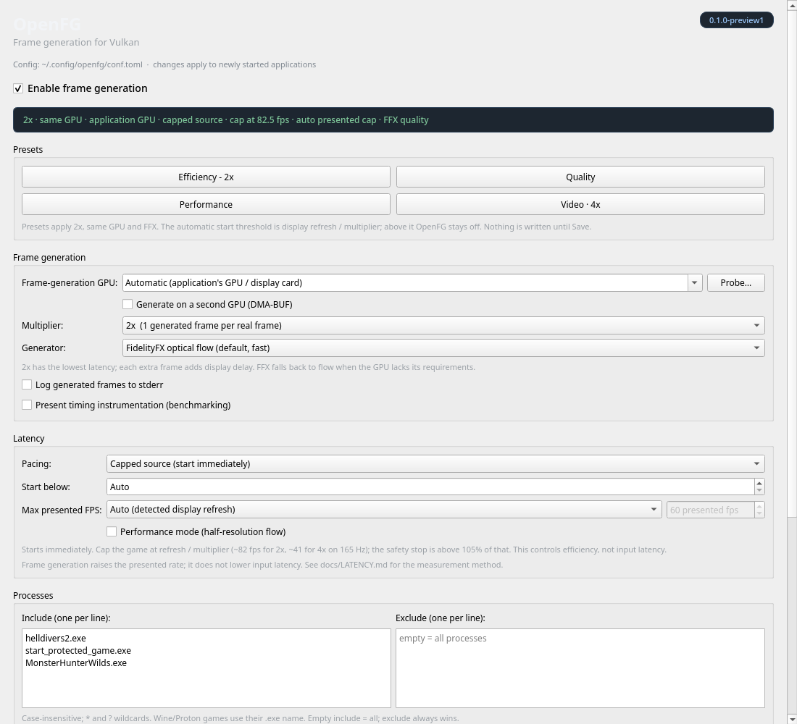

# OpenFG

[](https://github.com/sky-is-green/openfg/actions/workflows/build.yml)
[](LICENSE)

OpenFG is open frame generation for Linux: an implicit Vulkan layer that
inserts 2x, 3x or 4x interpolated frames into any Vulkan application — games,
emulators and Vulkan video players — without modifying the app.

The default backend is AMD's MIT-licensed FidelityFX Optical Flow, with an
automatic fallback to OpenFG's original optical-flow pipeline. A static-UI
mask keeps HUD text sharp on generated frames.

> No Lossless Scaling assets, no `lsfg-vk.dll`, and no lsfg-vk source code are
> used here. The vendored FidelityFX shaders and their notices are under
> `src/openfg/shaders/ffx/`; see [THIRD_PARTY.md](THIRD_PARTY.md).

**Status:** `v0.1.0-preview1` — the layer is core feature-complete and
real-game tested on RDNA3. Current `main` also has the FidelityFX default, the
dense static-UI mask, the activation gate, per-game profiles and a status tray.
The companion `openfg-scaler` has a working PipeWire/DMA-BUF capture, EASU/RCAS
and click-through preview, but still needs a real-game window pass. Broader GPU
validation and distribution packages remain open. Read the
[technical white paper](docs/OPENFG-WHITEPAPER.md) for the full design.

## Features

| Feature | Support |
|---|---|
| **Frame insertion** | 2x, 3x and 4x |
| **Backends** | FidelityFX optical flow (default), original OpenFG flow, linear blend, hold, timing-only off |
| **GPUs** | Same-GPU (OpaqueFd) and same-vendor cross-GPU (DMA-BUF) |
| **Pacing** | Adaptive or capped source; target FPS; refresh-aware presented-frame cap |
| **Activation gate** | Starts below display refresh ÷ multiplier (82.5 fps for 2x on 165 Hz); no generator work above it |
| **Profiles and status** | Per-game TOML profiles and an `openfg-tray` status indicator with autostart |
| **Display** | 8-bit and 10-bit/HDR half-float swapchains; multiple swapchains per device |
| **Content** | Process include/exclude, native and Wine/Proton names, video profile with scene-cut guard |
| **HUD** | Static-UI mask removes doubled HUD text on generated frames |
| **Controls** | TOML config, `OPENFG_*` overrides, CLI and Qt control panel |
| **Companion scaler** | `openfg-scaler`: PipeWire ScreenCast window/monitor capture over DMA-BUF, EASU/RCAS, optional 2x neural model, SDL3 fullscreen presenter, click-through overlay, headless dump |
| **Tooling** | `fg-lab`, `scaler-lab`, `scaler-gpu`, model-contract validator, synthetic benchmarks, HUD regression, log reports, GPU probe |

## Quick start

Build and install for the current user:

```sh
git clone https://github.com/sky-is-green/openfg
cd openfg
scripts/install-local.sh        # builds and installs under ~/.local
scripts/install-gui.sh          # optional; needs PySide6
scripts/install-gui.sh --dev    # symlink the repo copy for UI work

openfg-cli init                 # writes ~/.config/openfg/conf.toml if missing
$EDITOR ~/.config/openfg/conf.toml
openfg-cli validate
openfg-gpu-probe
openfg-tray &                   # optional status indicator
```

A minimal config:

```toml
[openfg]
enabled = true
generator = "ffx"
gpu = "auto"
cross_gpu = false
multiplier = 2
```

Then launch the game. The layer is installed implicitly, so every Vulkan
process loads it; the config decides whether it is active. Use
`DISABLE_OPENFG=1` to bypass it for one process.

## Control panel

`openfg-gui` edits the same file. It includes presets, the activation gate, a
GPU capability probe, application filters, video profiles, per-game profiles
and a live summary of the effective mode.

For UI work, `scripts/install-gui.sh --dev` symlinks the installed launchers to
the repo copies; edits appear on the next launch without reinstalling.

`openfg-tray` is a small status indicator. It reads
`$XDG_RUNTIME_DIR/openfg/status.json` (falling back to
`$XDG_STATE_HOME/openfg/status.json`) and shows green while generating, blue
while idle above the gate, and gray when no game is active. Start it from the
application menu or run `openfg-tray`; the tray menu can enable **Start at
login**.



Presets:

- **Efficiency - 2x** — 2x only below the automatic refresh ÷ multiplier threshold; capped source, FFX.
- **Always 2x** — 2x on every real frame, full-resolution FFX. No threshold; the presented rate can exceed the display.
- **Always 2x · Fast** — 2x on every real frame, half-resolution flow, ~50% cheaper at 1440p.
- **Video · 4x** — 4x for a Vulkan player, adds `mpv` and the cut guard.

Nothing is written until **Save**. Changes apply to applications started
afterwards.

## Efficiency threshold

OpenFG only generates when the game is below the activation threshold. The
automatic threshold is **display refresh ÷ multiplier**:

| Display | 2x | 3x | 4x |
|---:|---:|---:|---:|
| 165 Hz | 82.5 fps | 55 fps | 41.25 fps |
| 144 Hz | 72 fps | 48 fps | 36 fps |
| 120 Hz | 60 fps | 40 fps | 30 fps |

The threshold is a **source** rate. With 2x, 82.5 source = 165 presented;
120 source would be 240 presented, beyond a 165 Hz display. The UI labels it
**Start below (source)**.

Above that rate (with a small hysteresis band) the layer turns off: no
generated frames, no generator work and no added display delay. That is what
makes uncapped gameplay quiet, and it is the efficiency feature the UI exposes
as **Start below**.

- Leave **Start below** at *Auto* to use the automatic threshold from
  **Max presented FPS**.
- Set **Start below** to a lower rate to keep generation off at lower frame
  rates and save more GPU.
- Set **Max presented FPS** to a custom value if the display refresh is wrong
  or you intentionally want a different presented cap.
- Turn **Max presented FPS** off to use **Start below** alone. That allows a
  threshold above refresh ÷ multiplier, which can exceed the display and add
  delay.

To disable the gate entirely, use **Max presented FPS: Off** and
**Start below: Auto**, or the **Always 2x** preset. The layer then generates
on every real frame, even when the presented rate exceeds the display.

The panel also reports the display cadence. For the cleanest motion, the
presented rate should divide the refresh evenly: 60 and 120 fps on a 120 Hz
mode are exact, while 60/120 on 165 Hz alternate between two and three (or one
and two) refresh intervals and look uneven.

This is an efficiency control, not an input-latency reduction. For lower
latency, use the highest source rate that still leaves room for 2x (for
example 60→120 or about 82→164 on 165 Hz), and prefer 2x over 3x/4x.

## Companion scaler (preview)

`openfg-scaler` is the in-repo capture/upscale/present module. It is not
required by the frame-generation layer and shares the same CMake project,
`vkutil`, shader embedding and releases.

```sh
cmake -S . -B build -G Ninja
cmake --build build --target openfg-scaler

# Synthetic window: 1280x720 -> 2560x1440, EASU + RCAS.
./build/openfg-scaler --source test --windowed \
  --input 1280x720 --output 2560x1440

# PipeWire window capture. The portal asks once; the restore token is
# remembered for later runs. Select the game window, not the scaler.
./build/openfg-scaler --source pipewire --capture window \
  --input 1920x1080 --crop 1920x1080+0+28 \
  --output 2560x1440 --fullscreen --sharpness 4

# Native/A-B reference: no EASU, present the captured frame directly.
./build/openfg-scaler --source pipewire --capture window \
  --input 1920x1080 --crop 1920x1080+0+28 \
  --output 1920x1080 --filter passthrough
```

Modes are deliberately labelled by cost, not by quality:

| Mode | Source -> output | Notes |
|---|---|---|
| **Performance** | 1080p -> 1440p | EASU + RCAS; playable, but not a native-quality image |
| **Ultra performance** | 720p -> 1440p | 4x pixel increase; visibly soft/noisy on high-detail scenes |
| **Native reference** | source = output, `--filter passthrough` | No spatial upscale; for A/B and latency |
| **Quality** | native 1440p or neural | Native is not a scaler mode; the v0 neural runtime is a local proxy, not a shipping quality backend |

The PipeWire path requests DMA-BUF, fixates the negotiated DRM modifier,
announces a single buffer block, caches imported images and falls back to
shared memory with `--no-dmabuf`. The portal selection is stored in
`$XDG_STATE_HOME/openfg/portal-<capture>-token` (mode 0600); use
`--forget-token` to prompt again.

Fullscreen PipeWire mode is a non-focusable Wayland overlay with an empty
input region, so mouse clicks pass through and the game keeps focus.
`--no-click-through` restores a normal interactive window. On X11 the mouse
region is not available. Escape cannot close a click-through overlay; stop the
process from the terminal/tray.

Measured on the RX 7900 XT with GravityMark 1.89 as a 1080p window, upscaled to
2560x1440:

- 600 frames in 9.96 s: **60.25 fps**.
- Acquire **0.03 ms** p50, submit **0.48 ms** p50.
- Capture-to-present **0.71 ms** p50.
- EASU+RCAS **0.29 ms** p50; present pass **0.10 ms** p50. The standalone
  `scaler-gpu` harness reports a larger end-to-end EASU+RCAS figure because it
  times a different sequence; compare within each harness.
- `--present-timing` adds a display wait and drops the same run to 55.2 fps;
  it is a measurement mode, not a normal-play setting.

The current EASU result matches `scaler-gpu` within 1 LSB on the self-test
vector. 1080p is the performance option; 720p is ultra performance. Neither is
a quality mode. Native 1440p and a production neural upscaler remain the quality
reference. See [docs/SCALER.md](docs/SCALER.md) for interfaces, validation and
the remaining real-game/VRR/HDR work.

### Neural 2x v0 (optional)

The training lane's first package is a 20-channel, 3-block residual CNN with a
PixelShuffle 2x head and 24,452 parameters. On the held-out Wilds proxy set it
beats Lanczos on LPIPS (`0.1168` vs `0.1340`) and DISTS (`0.01114` vs
`0.01141`), with PSNR/SSIM at parity. The HUD/text crop also wins LPIPS/DISTS,
but its SSIM is slightly below Lanczos (`0.9331` vs `0.9345`).

EASU remains a strong baseline. On the same 340 pairs, EASU+RCAS at maximum
sharpening has LPIPS `0.0657` but PSNR/SSIM `31.627`/`0.9163`, versus the
neural `33.455`/`0.9517` and Lanczos `33.432`/`0.9515`. On the 40-pair
default-sharpness subset, EASU is `0.1118` LPIPS / `32.277` PSNR / `0.9375`
SSIM, EASU+RCAS at 4 is `0.1094` / `32.280` / `0.9377`, and the neural model
is `0.1250` / `32.788` / `0.9453`. The neural model's defensible claim is
"beats Lanczos on LPIPS/DISTS at PSNR/SSIM parity", not "beats EASU". The
sharpening/fidelity trade-off needs real-game judgement.

The weights are **local-only** because they were trained on game footage. The
synthetic pretrain is the public integration artifact. The model is 2x:

- 720p -> 1440p is the intended performance point.
- 1080p -> 4K is 2x.
- 1080p -> 1440p is 1.33x and remains an EASU path; the runtime rejects it.

The default runtime is a zero-copy Vulkan backend. Convert the package once:

```sh
python3 tools/model-ofg.py /path/to/model-package
openfg-scaler --source pipewire --capture window --filter neural \
  --model /path/to/model-package/model.ofg \
  --input 1280x720 --crop 1280x720+0+28 \
  --output 2560x1440 --fullscreen
```

The backend records the convolution and PixelShuffle passes in the same
command buffer as presentation; no frame data leaves the GPU. On the RX 7900
XT it measured **7.0 ms p50 / 8.8 ms p95** of GPU compute at
720p -> 1440p (about 109 fps headless), and 15.3 ms p50 at 1080p -> 4K. The
output matched the training model to 1 LSB on the deterministic test pattern.
The training lane's PyTorch/MIOpen proxy is 2.29 ms, so direct-convolution
tuning (FP16, register tiling) is still future work.

The optional ncnn backend remains available for validation with a `.param`
model, but it reads the frame back through CPU memory and measured about
32 ms p50 at 720p -> 1440p. It is not the production path.

## How it works

1. The layer hooks instance/device/swapchain/present.
2. Two real frames are copied to the compute backend, which estimates optical
   flow and renders the intermediate frame at `t=0.5` (`0.25/0.5/0.75` for 4x).
3. Interpolated frames are presented before the current real frame. Static HUD
   text is detected and copied from an unwarped source, so it cannot double.
4. Anything unsupported falls back to passthrough: separate present queue
   families, no free swapchain image, or missing Vulkan features.

## Configuration

The layer reads `$XDG_CONFIG_HOME/openfg/conf.toml`, falling back to
`~/.config/openfg/conf.toml`. `OPENFG_CONFIG` overrides the path.

### Per-game profiles

The layer also looks for a profile named after the current process in
`$XDG_CONFIG_HOME/openfg/profiles/<process>.toml` (default
`~/.config/openfg/profiles/`). If a profile exists, it is used instead of the
base config for that process. `OPENFG_CONFIG` still wins over profiles;
`OPENFG_PROFILE_DIR` overrides the profile directory.

The control panel's **Profiles** button saves the current settings as a full
profile and sets its process include to the name you enter. A profile is a
complete config, not a partial override, so copy the settings you want it to
use.

| Key | Default | Meaning |
|---|---|---|
| `enabled` | `false` | Master switch. The layer is inactive unless this is true. |
| `gpu` | `"auto"` | Interpolation GPU: `auto`, PCI address, device name or `vendor:device`. |
| `cross_gpu` | `false` | Run on `gpu` and share frames with the display GPU over DMA-BUF. |
| `multiplier` | `2` | Generated frames per real frame: 2, 3 or 4. |
| `generator` | `"ffx"` | `ffx`, `flow`, `blend`, `hold` or `off`. |
| `performance_mode` | `false` | Half-resolution flow: cheaper, slightly softer edges. |
| `pacing` | `"adaptive"` | `adaptive` waits for a sustained drop; `capped` starts immediately. |
| `target_fps` | `0` | Manual source-rate threshold. `0` = no manual threshold; the presented cap still applies. The effective threshold is `min(target_fps, max_presented_fps / multiplier)`. |
| `max_presented_fps` | `0` | Presented-frame cap; also sets the automatic activation threshold when non-zero. `-1` = detected display refresh; `0` = off. |
| `present_timing` | `false` | Present-id/wait latency instrumentation. |
| `debug` | `false` | Per-frame logging to stderr. |
| `[processes] include` | `[]` | Application allow-list (Wine/Proton `.exe` names); empty means all. `*` and `?` are supported. |
| `[processes] exclude` | `[]` | Always passthrough; wins over include. |
| `[video] processes` | `[]` | Players that use the video profile. |
| `[video] multiplier` | `4` | Video multiplier. |
| `[video] target_fps` | `0` | Video source-rate cap. `0` = always. |
| `[video] performance_mode` | `false` | Use half-resolution flow for video. |
| `[video] safe` | `true` | Scene-cut guard: show the current frame on a hard cut. |

Environment overrides: `OPENFG_ENABLE`, `OPENFG_GPU`, `OPENFG_CROSS_GPU`,
`OPENFG_MULTIPLIER`, `OPENFG_TARGET_FPS`, `OPENFG_MAX_PRESENTED_FPS`,
`OPENFG_PERFORMANCE_MODE`, `OPENFG_GENERATOR`, `OPENFG_PACING`,
`OPENFG_PRESENT_TIMING`, `OPENFG_DEBUG`, `OPENFG_REFRESH` and
`OPENFG_NO_UI_MASK`.

### Launch options

The layer reads the config file automatically. For Steam, paste overrides into
**Properties → Launch Options**; `%command%` is replaced by Steam. For other
launchers, prefix the same variables to the command.

```bash
# Disable OpenFG for one run
DISABLE_OPENFG=1 %command%

# Force enable even if the config says enabled = false
OPENFG_ENABLE=1 %command%

# Use another config file
OPENFG_CONFIG=/path/to/another-conf.toml %command%

# Cap presented frames; with 2x the source gate is 30 fps
OPENFG_MAX_PRESENTED_FPS=60 %command%

# Set a manual source gate
OPENFG_TARGET_FPS=120 %command%

# Write the layer log to a file
OPENFG_LOG=/path/to/openfg.log %command%

# Pin the generator and pacing
OPENFG_GENERATOR=ffx OPENFG_PACING=capped %command%

# Force debug logging
OPENFG_DEBUG=1 %command%
```

The control panel's **Launch options** button generates one line from the
current controls, including the generator and pacing, and copies it with one
click.

`DISABLE_OPENFG=1` wins over everything. If display detection fails, add
`OPENFG_REFRESH=165`. The config file is read once, when the application
starts. The control panel has the same examples behind **Launch options**.

### Pacing, HDR and cross-GPU

- **Pacing.** `max_presented_fps = -1` is the low-latency setting: it stops
  generation when `source fps × multiplier` would exceed the detected display
  refresh. The layer reads the active DRM mode; set `OPENFG_REFRESH` if the
  sandbox hides `/dev/dri/card*`.
- **Multiplier.** 2x has the lowest added delay. Generated frames are shown
  before the current real frame, so 3x/4x add more display delay.
- **Cross-GPU.** Same-vendor only. It removes work from the render card but
  adds two DMA-BUF copies and cross-device semaphore round-trips; it was
  slower than same-GPU in Helldivers 2 (119 vs 134 fps).
- **HDR.** 10-bit and HDR swapchains use the RGBA16F path. HDR10 PQ is
  interpolated in code values, not linear light.

## Backends

| Generator | What it is | Notes |
|---|---|---|
| `ffx` | AMD FidelityFX Optical Flow, 8×8 block field | Default. Fastest, includes the static-UI mask. Falls back to `flow` when unsupported. |
| `flow` | OpenFG's original dense optical flow | Compatibility path. No static-UI mask yet. |
| `blend` | Linear A/B blend | Comparison baseline. |
| `hold` | Repeat the current frame | Comparison baseline. |
| `off` | Layer loaded, no generation | Latency baseline. |

For normal play, use `ffx`. `flow` is the fallback/alternative; `blend` and
`hold` are comparison baselines, and `off` is for timing.

All backends use the same photo-consistency interpolation and visibility
weighting. FidelityFX replaces only the per-pixel flow estimator. See
[docs/FFX.md](docs/FFX.md) for the pass sequence, measurements and licensing.

## Performance

Synthetic 1440p scenes, 100 `fg-lab` iterations, RX 7900 XT:

| Backend | Pan ms | Pan dB | Zoom dB | Occlude dB | Ghost dB | Ghost excess |
|---|---:|---:|---:|---:|---:|---:|
| `flow` | 1.56 | 32.83 | 28.49 | 21.30 | 26.49 | 1.925 |
| `flow` performance | 0.85 | 32.50 | 28.34 | 21.24 | 26.45 | 1.951 |
| `ffx` | 0.98 | 33.17 | 31.94 | 21.18 | 26.59 | **1.922** |
| `ffx` performance | 0.49 | 33.00 | 31.80 | 21.17 | 26.55 | 1.951 |

FFX is about 1.6–1.7× faster and matches the flow ghost gate within noise.
Its only synthetic regression is the thin-occluder scene (~0.1 dB), where an
8×8 block contains both the occluder and its background. FFX timings include
the static-UI mask (about 0.06 ms at 1440p performance mode).

Real-world reference points:

- Monster Hunter Wilds, 1440p max, FFX: 75–98 app fps → 123–145 presented fps,
  ~1.2–1.5 ms layer overhead, 4-minute capture with no faults.
- Helldivers 2: cross-GPU 119 fps vs same-GPU 134 fps.
- mpv/gpu-next, 24 fps H.264 at 4x: ~96 presented fps. Scene-cut guard moved
  a hard cut from 12.21 dB (blend) to 99 dB (current frame).
- Present-latency measurements and caveats: [docs/LATENCY.md](docs/LATENCY.md).

## Roadmap

Near term (layer and control panel):

- [x] Per-game profiles: process-named full configs, GUI save dialog.
- [x] Status tray: atomic layer status JSON, generating/idle/stale icon and
      autostart.
- [ ] Benchmark/telemetry mode: live p50/p95, overhead, CSV/JSON export.
- [ ] Auto-tune the gate and multiplier from display refresh and frame time.
- [ ] Reduce start/stop churn and improve frame pacing.
- [ ] HDR/VRR-aware presentation and pacing.
- [ ] Compatibility profiles: community-tested per-game recommendations.

Companion scaler:

- [x] PipeWire ScreenCast capture (window/monitor), DMA-BUF import,
      shared-memory fallback, restore-token persistence.
- [x] FSR1 EASU/RCAS and SDL3 windowed/fullscreen presentation.
- [x] Headless capture/present, RGBA dump and GPU pass timestamps.
- [x] Click-through, non-focusable Wayland overlay (mouse verified).
- [x] Native `--filter passthrough` reference.
- [ ] Real-game window validation, focus/keyboard check and capture overhead
      comparison.
- [ ] Gamescope-style nested-compositor backend.
- [ ] Integer scaling, configurable aspect policy and explicit
      `SPA_DATA_SyncObj` synchronization.
- [ ] HDR and VRR in the capture/present path.
- [x] ~~Neural spatial v0 runtime: zero-copy Vulkan backend, optional ncnn
  validation path.~~
- [ ] Faster direct-convolution kernels (FP16/register tiling) toward the
  2.29 ms PyTorch proxy, and a model plugin API.
- [ ] Real-capture v1 model and broader game evaluation.
- [ ] Measure capture-to-present latency against native and Lossless Scaling.

Research:

- [ ] Neural frame generation: small flow/interpolation model vs FFX flow.
- [ ] Capture-based temporal approximation: recurrent upscaler with estimated
      flow and history, without engine motion vectors or depth.
- [ ] Training pipeline: local high-fps captures, held-out-game evaluation and
      synthetic data.
- [ ] Compare upscale -> frame-gen against frame-gen -> upscale for quality and
      latency.
- [ ] Publish models, training code and evaluation scripts on Hugging Face.

Benchmarks:

- [x] Offline `scaler-lab` v0: synthetic/real pairs, nearest/bilinear/bicubic/
      Lanczos, PSNR/SSIM and CSV reports.
- [x] FSR1 EASU/RCAS baseline in `scaler-gpu` (Vulkan; ~0.14 ms EASU,
      ~1.4 ms EASU+RCAS at 1440p).
- [x] EASU/RCAS backends in `scaler-lab` via `--backend` and `--scaler-gpu`.
- [x] `openfg-scaler` capture-to-present and per-pass GPU timestamps.
- [ ] Neural backend in `scaler-lab`.
- [ ] LPIPS/DISTS/VMAF, temporal metrics and HUD-region crops.
- [ ] Real-game window capture matrix and capture-overhead study.

Needs engine integration:

- [ ] True temporal upscaler with motion vectors, depth, jitter and masks.

A layer cannot reliably obtain motion vectors and depth from VKD3D without
game cooperation. Heuristic buffer detection or injection is fragile and can
trip anti-cheat, so the engine-data path is parked until a game or engine
partner wants the integration. The capture-based approximation is a separate
research item with a lower ceiling.

## HUD ghosting

Frame interpolation warps the whole image, including screen-locked HUD text.
The static-UI mask detects high-contrast detail that is identical in both
source frames, dilates the block mask, and samples it at the output and at both
warped source positions. Over that area the interpolator uses the unwarped
frame pair, so text stays sharp and its ghost halo disappears.

The detector uses a sparse prefilter followed by a dense 8x8 grid. The dense
grid is what catches alpha-blended HUD text: with a moving background, only
part of an anti-aliased glyph edge is unchanged between frames, and a sparse
grid can miss every unchanged pixel in a thin glyph.

The mask is FFX-only and covers static text. Moving or animated UI, and all UI
on the `flow` fallback, can still ghost. Disable it for A/B testing with
`OPENFG_NO_UI_MASK=1`. Regression tests: `tools/hud_bench.py` (opaque text) and
`tools/hud_alpha_bench.py` (75% text opacity).

## GPU support

| Setup | Requirements | Status |
|---|---|---|
| **Same-GPU** | Vulkan 1.2+, compute queue, timeline semaphores, `VK_KHR_synchronization2`, external memory/semaphore FD (OpaqueFd), R8_UNORM/R16G16_SFLOAT storage | RDNA3 tested. RDNA2/RDNA1, NVIDIA Turing+ and Intel Arc are expected; run the probe. |
| **Cross-GPU** | The above plus DMA-BUF export, both cards on the same vendor driver | Dual RX 7900 XT tested. Mixed AMD/NVIDIA/Intel is unsupported. |
| **FidelityFX** | Compute subgroups (basic/arithmetic/quad), R8_UINT/R16G16_SINT/R32_UINT-atomic storage | Default on capable GPUs; otherwise logs and falls back to `flow`. |

`openfg-gpu-probe` creates real 64×64 same-GPU and cross-GPU contexts and is
authoritative:

```sh
openfg-gpu-probe
```

See [docs/GPU-SUPPORT.md](docs/GPU-SUPPORT.md) for the vendor matrix and the
mixed-vendor semaphore limitation.

## Video

Use a Vulkan-presenting player and give it a video profile:

```toml
[video]
processes = ["mpv"]
multiplier = 4
target_fps = 0
performance_mode = false
safe = true
```

```sh
mpv --no-config --vo=gpu-next --gpu-api=vulkan --gpu-context=waylandvk \
    --hwdec=auto-safe /path/to/video.mkv
```

4x is the useful video setting: 24 fps becomes ~96 presented fps before display
pacing. `max_presented_fps = -1` leaves 50/60 fps material native instead of
multiplying it past the display refresh.

Known video limits: no PTS-aware cadence, HDR10 PQ is interpolated in code
values, and moving subtitles can ghost. See [docs/VIDEO.md](docs/VIDEO.md).

## Testing and benchmarks

```sh
ctest --test-dir build --output-on-failure

# Generate the 1440p synthetic scenes once; the raw files are not committed.
python3 tools/testdata/gen_frames.py --width 2560 --height 1440

python3 tools/bench.py --gpu auto --iterations 100 --generator ffx
python3 tools/ghost_bench.py --scene ghost --generator ffx
python3 tools/hud_bench.py --gpu auto
python3 tools/hud_alpha_bench.py --gpu auto
python3 tools/tile_bench.py --width 2560 --height 1440

# Summarise one or more layer logs
python3 tools/openfg-report.py raw/*.log --detail
```

Scaler checks:

```sh
# Headless self-test and dump (test pattern, no portal)
./build/openfg-scaler --headless --source test --static \
  --input 640x360 --output 1280x720 --frames 1 \
  --dump /tmp/scale-out.rgba --dump-input /tmp/scale-in.rgba

# Window capture (portal; select the game, not the scaler)
./build/openfg-scaler --source pipewire --capture window \
  --input 1920x1080 --crop 1920x1080+0+28 \
  --output 2560x1440 --fullscreen --sharpness 4

# Forget the saved portal permission
rm -f ~/.local/state/openfg/portal-window-token
# (--forget-token also clears it at the start of the next capture)
```

The standalone `scaler-gpu` harness runs FSR1 EASU/RCAS on raw RGBA and reports
GPU time:

```sh
./build/scaler-gpu --input low.rgba --output high.rgba \
  --width 1280 --height 720 --out-width 2560 --out-height 1440 \
  --filter easu+rcas --iterations 10
```

The interpolation harness (`fg-lab`) takes two raw RGBA frames and reports
PSNR and GPU time:

```sh
./build/fg-lab --a A.rgba --b B.rgba --gt GT.rgba --out out.rgba \
  --width 2560 --height 1440 --t 0.5 --gpu auto
```

The benchmark and plotting scripts need `numpy`, `Pillow`, `scipy` and
`matplotlib` (`python3 -m pip install -r tools/requirements.txt`). They
default to `flow` so old comparisons stay comparable; pass `--generator ffx`
for the shipped default.

`hud_bench.py` builds a 48-pixel pan with static text and requires at least a
50% reduction in halo ghost energy with the mask enabled. Current run: 95.6%
reduction, +2.61 dB. `hud_alpha_bench.py` repeats it with 75% text opacity:
94.7% at 720p and 91.3% at 1440p.

Layer configuration options, expected output and the reporting checklist are
in [docs/TESTING.md](docs/TESTING.md). CI builds with clang and gcc
(`-Werror`) on Ubuntu 24.04, with the optional SDL3/PipeWire/Wayland
dependencies absent, runs the config/status tests, smoke-tests the CLI and
checks the Python syntax. The full capture/present path is tested locally on
Wayland.

## Build and install

Requirements: C++20 compiler, CMake 3.20+, Ninja, `glslc` (shaderc),
`glslangValidator` (glslang), Vulkan headers (vendored) and Python 3 for
shader embedding. The scaler's optional dependencies are SDL3 (window
presenter), `libpipewire-0.3` + `dbus-1` (capture), `wayland-client`
(mouse click-through) and `ncnn` (optional neural validation backend); a build
without them is headless/test-pattern only. The native `.ofg` neural path
needs only Vulkan; ncnn is required only for `.param` models.

```sh
cmake -S . -B build -G Ninja -DCMAKE_BUILD_TYPE=Release
cmake --build build -j"$(nproc)"

# per-user, no root
scripts/install-local.sh
scripts/install-gui.sh

# or system-wide
sudo cmake --install build --prefix /usr/local
```

The build produces:

- `libopenfg-layer.so` and the implicit-layer manifest
- `openfg-cli`, `openfg-gpu-probe`, `fg-lab`, `scaler-gpu`
- `openfg-scaler` (headless without SDL3/PipeWire; full capture/present with
  them)
- optional `openfg-gui` and `openfg-tray` (PySide6)

Arch/CachyOS users can build `packaging/PKGBUILD` with `makepkg -si`. AUR and
Flatpak packages are not published yet.

## Limitations

- The static-UI mask is FFX-only and only covers screen-locked text. Moving or
  animated UI, and all UI on the `flow` fallback path, can still ghost.
- Mixed-vendor cross-GPU is unsupported; the timeline-semaphore handoff uses
  driver-private `OPAQUE_FD` handles.
- Video is limited to Vulkan-presenting players. PTS-aware cadence, linear-light
  HDR and moving-subtitle masking are still open.
- The present queue and blit commands must share a queue family. Separate
  present queue families fall back to passthrough.
- Extra swapchain images are acquired with a zero timeout; a frame is shown
  without interpolation when no image is free. This avoids blocking the
  application's event loop on Wayland.
- RDNA2/RDNA1, NVIDIA and Intel are expected to meet the Vulkan requirements
  but have not been validated on real hardware here.
- The companion scaler has no real-game window validation yet. PipeWire
  window capture adds compositor overhead; 1080p is a performance mode, not a
  quality mode, and 720p is visibly soft on high-detail content.
- Click-through mouse input is Wayland-only. The overlay is non-focusable on
  both, but X11 does not get an empty input region.
- The scaler does not wait on explicit `SPA_DATA_SyncObj` synchronization and
  does not support HDR/VRR yet.
- The native neural v0 runtime is ~7 ms p50 at 720p -> 1440p, still about 3x
  the PyTorch/MIOpen proxy, and 1080p -> 4K is ~15 ms (below 60 fps). The
  proxy weights are local-only, the model is 2x, and HUD SSIM is slightly
  below Lanczos. The ncnn `.param` path is validation-only.
- Input-to-photon latency is not measured; only present latency and generator
  cost are.
- The backend's Vulkan device/instance is intentionally leaked at process exit:
  destroying it while the application device still has imports can hang RADV.
  Per-swapchain resources are still destroyed.

## Documentation

| Document | Contents |
|---|---|
| [docs/OPENFG-WHITEPAPER.md](docs/OPENFG-WHITEPAPER.md) | Full design and implementation paper |
| [docs/FFX.md](docs/FFX.md) | FidelityFX backend, static-UI mask, measurements, licensing |
| [docs/GPU-SUPPORT.md](docs/GPU-SUPPORT.md) | Vulkan requirements, vendor matrix, cross-GPU limitation |
| [docs/LATENCY.md](docs/LATENCY.md) | Pacing modes, measured latency, generator cost |
| [docs/TESTING.md](docs/TESTING.md) | Install checks, test matrix, reporting checklist |
| [docs/VIDEO.md](docs/VIDEO.md) | mpv setup, scene-cut guard, video limitations |
| [docs/REPORTING.md](docs/REPORTING.md) | Layer-log metrics and `openfg-report` |
| [docs/MODEL-CONTRACT.md](docs/MODEL-CONTRACT.md) | Neural model package and fixed test-vector contract |
| [docs/SCALER.md](docs/SCALER.md) | Companion scaler architecture, capture backends, upscaler interfaces |
| [tools/scaler-lab/DATASET.md](tools/scaler-lab/DATASET.md) | scaler-lab dataset schema and capture protocol |

## License

MIT. See [LICENSE](LICENSE) and [THIRD_PARTY.md](THIRD_PARTY.md). FidelityFX
Optical Flow is AMD MIT-licensed code; keep the notices under
`share/licenses/openfg/ffx/` when redistributing binaries.
