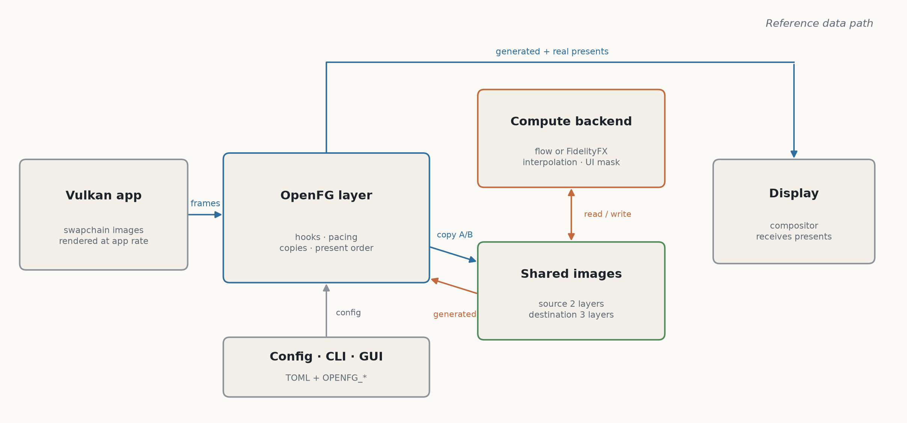
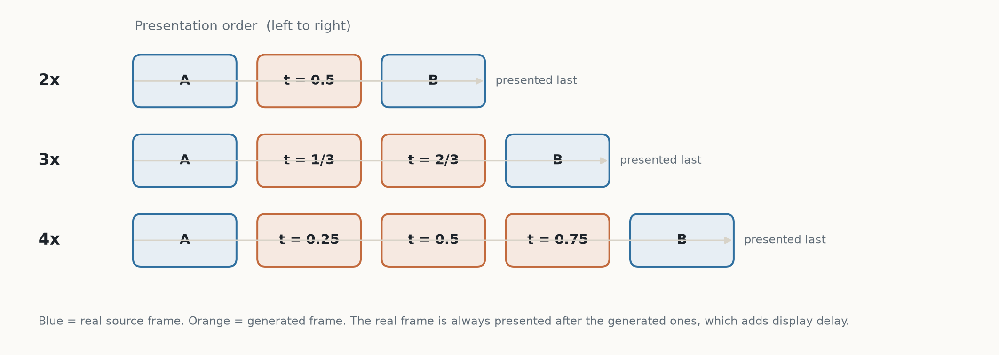
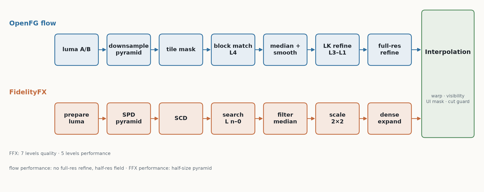
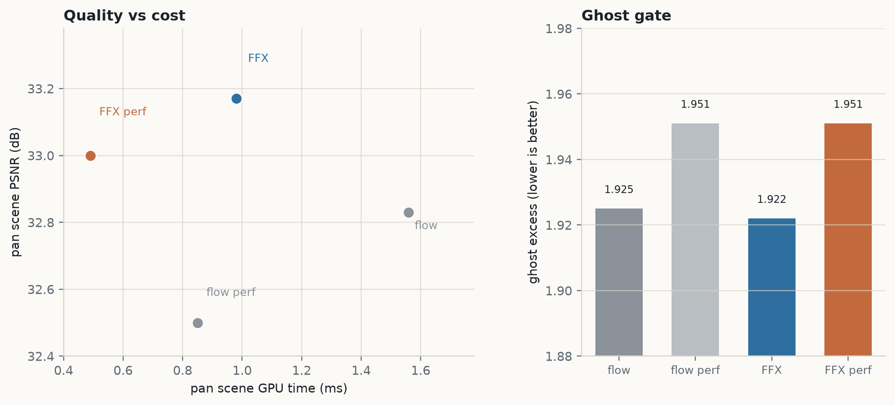
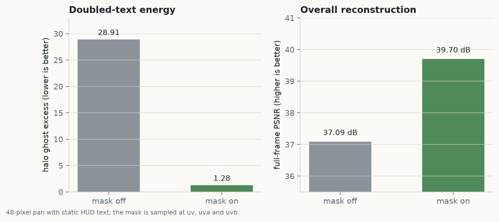
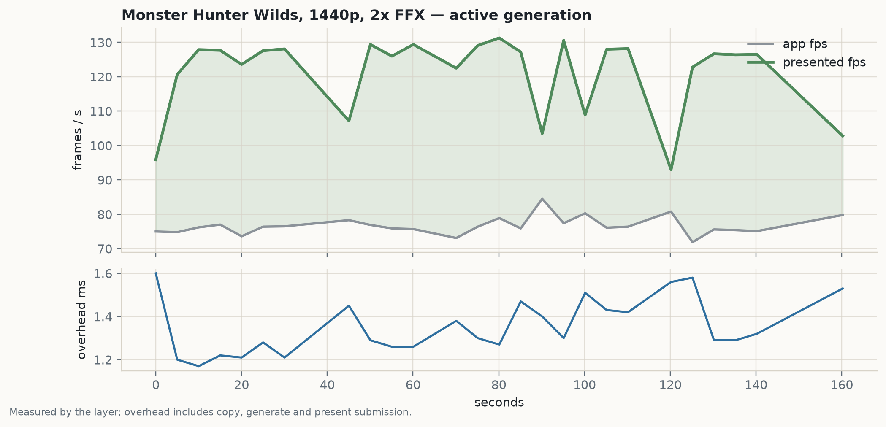

# OpenFG: Frame Generation for Vulkan on Linux (WIP)

**An MIT-licensed optical-flow layer with a static-UI mask, measured on RDNA3.**

**sky-is-green** · Technical white paper · November 2026 \
Project: <https://github.com/sky-is-green/openfg> · License: MIT

The FidelityFX backend and static-UI mask are
measured; the final fast-pan HUD confirmation is synthetic, and broader GPU
validation and distribution packages are open.

This is the paper: the architecture, the two optical-flow backends, the exact
interpolation and HUD-mask math, the pacing and synchronization protocols, and
the measured results on the reference dual-RX-7900-XT system. The code is in
[the repository](https://github.com/sky-is-green/openfg); the synthetic scenes
and benchmarks are in `tools/`; the figures are regenerated by
[`tools/make_paper_figures.py`](../tools/make_paper_figures.py). Measurements
are current to November 2026.

The layer is installed as an implicit Vulkan layer. It uses no Lossless
Scaling assets, no `lsfg-vk.dll`, and no lsfg-vk source code. FidelityFX
Optical Flow is AMD MIT-licensed code; the notices are in the repository.

**Contents**

- [Abstract](#abstract)
- [The claim in one page](#the-claim-in-one-page)
- [1. The problem](#1-the-problem)
- [2. Background and related work](#2-background-and-related-work)
- [3. System architecture](#3-system-architecture)
- [4. The layer and present path](#4-the-layer-and-present-path)
- [5. The flow backends](#5-the-flow-backends)
- [6. Frame synthesis and HUD protection](#6-frame-synthesis-and-hud-protection)
- [7. Pacing and latency](#7-pacing-and-latency)
- [8. Cross-GPU and HDR](#8-cross-gpu-and-hdr)
- [9. Configuration and failure model](#9-configuration-and-failure-model)
- [10. The measured results](#10-the-measured-results)
- [11. Threats to validity and what is not claimed](#11-threats-to-validity-and-what-is-not-claimed)
- [12. Open questions](#12-open-questions)
- [13. Reproduce](#13-reproduce)
- [14. License and community invitation](#14-license-and-community-invitation)
- [References](#references)

## Abstract

OpenFG is an implicit Vulkan layer that inserts 2×, 3× or 4× interpolated
frames into any Vulkan application's swapchain without modifying it. The
default FidelityFX optical-flow backend reaches 33.17 dB on the 1440p pan
scene at 0.98 ms per synthetic frame pair (32.83 dB at 1.56 ms for the
original flow backend); the static-UI mask removes 95.6% of the halo ghost
energy caused by doubled HUD text; and a four-minute Monster Hunter Wilds
session rendered at 75–98 app fps while presenting 123–145 fps at 1.2–1.5 ms
of layer overhead. This paper documents the layer hooks and present protocol,
both flow pipelines, the interpolation and mask math, pacing, cross-GPU and
HDR paths, the evaluation methodology, and the limits of the evidence.

## The claim in one page

| the claim | the measurement |
|---|---|
| FidelityFX is the better default | 0.98 ms / 33.17 dB on the 1440p pan scene, against 1.56 ms / 32.83 dB for the original flow backend |
| HUD text can be protected | 95.6% less halo ghost energy and +2.61 dB full-frame PSNR on a 48-pixel pan with static text |
| Real games benefit | Monster Hunter Wilds at 1440p: 75–98 app fps → 123–145 presented fps at 1.2–1.5 ms layer overhead |
| Video works at 4× | 24 fps H.264 → about 96 presented fps; the cut guard moves a hard cut from 12.21 dB to 99 dB |
| Cross-GPU is same-vendor only | 119 fps cross-GPU vs 134 fps same-GPU in Helldivers 2 |

Three results carry the paper:

1. **Separate motion estimation from frame synthesis.** The flow backend
   produces a field; one interpolation shader applies photo-consistency,
   static-detail protection, the UI mask and the cut guard. FidelityFX is a
   drop-in replacement rather than a second renderer.
2. **Protect static UI spatially, not per pixel.** A per-pixel test covers the
   glyph core but not the halo that a warp drags into the background. The
   block mask, sampled at the output and at both warped source positions,
   removes the halo; the cheaper failure modes are kept in §6.3.
3. **Default to FidelityFX, keep flow as the compatibility path.** The layer
   falls back automatically when the device lacks the required subgroups or
   storage formats.

What is not claimed: frame generation improves motion smoothness and the
presented rate; it adds display latency and does not raise the application's
render rate. The UI mask covers static text only, HDR is interpolated in code
values, and mixed-vendor cross-GPU is unsupported. These limits are stated
again, with the evidence, in §11.

---

## 1. The problem

### 1.1 Why frame generation, and why Linux

Frame generation increases the number of presented frames by synthesising
intermediate images between two rendered frames. On a fixed-refresh display
it can make motion look smoother when an application renders below the display
rate, and it can raise the presented rate without raising the application's
simulation or render rate.

It does **not** reduce input latency. Generated frames are presented before
the current real frame, so the real frame is delayed by at least the number of
inserted presents. OpenFG exposes this trade explicitly through its multiplier,
pacing and presented-frame cap.

On Linux, the practical options have been proprietary, Windows-derived, or
tied to specific compositors. I built OpenFG because none of those fit the
constraint I cared about: a layer any Vulkan application could load, with an
MIT implementation and a quality gate that could be measured rather than
asserted. It needs no DLL replacement, no compositor patch and no application
integration. It also serves as a readable reference for how a frame-generation
layer can be built on Vulkan's external-memory and timeline-semaphore
primitives.

### 1.2 What this paper contributes

- A complete Vulkan layer that modifies the swapchain, imports shared images,
  inserts generated presents and restores the application's present chain.
- An original optical-flow pipeline: luma pyramid, zero-mean SAD block
  matching, Lucas–Kanade refinement, vector median, guided smoothing, and
  optional full-resolution refinement.
- An integration of FidelityFX Optical Flow 1.1.2 that reuses the same
  interpolation stage and falls back to the original flow path when the device
  lacks the required subgroups or storage formats.
- A photo-consistency interpolation stage with visibility weighting, a
  static-detail guard, a static-UI mask for HUD text, and a global scene-cut
  guard.
- Same-GPU (OpaqueFd) and same-vendor cross-GPU (DMA-BUF) transport with a
  timeline-semaphore handoff.
- Refresh-aware pacing, adaptive/capped start-stop logic, and optional
  present-latency instrumentation.
- A reproducible evaluation on synthetic scenes and real games, including a
  targeted HUD-ghosting regression test.

### 1.3 Scope and non-goals

OpenFG is a Vulkan layer. It only sees applications that present through a
Vulkan swapchain. It is not a compositor, a desktop-wide injector, or a
video-player plugin. It does not perform PTS-aware video cadence, linear-light
HDR tone mapping, mixed-vendor cross-GPU synchronization, or input-to-photon
latency measurement. Section 11 lists the resulting limits.

---

## 2. Background and related work

### 2.1 Temporal interpolation

Given two rendered frames $A$ (previous) and $B$ (current), frame generation
estimates a motion field $v$ and synthesises a frame at time
$t \in (0,1)$:

$$
u_a = u - t\,v, \qquad u_b = u + (1-t)\,v
$$

where $u$ is the output pixel coordinate and $v$ is expressed in output
pixels. The two warped samples are blended. Correct handling of occlusions,
disocclusions, transparent surfaces, thin geometry, scene cuts and
screen-locked UI is what separates a usable interpolator from a naive blend.

OpenFG stores flow as $v = B - A$ (previous to current). FidelityFX stores
the opposite sign; the dense-expansion pass negates it at the boundary.

### 2.2 Vulkan layers and swapchain presentation

A Vulkan implicit layer is loaded by the loader for every Vulkan process and
exports `vkGetInstanceProcAddr` / `vkGetDeviceProcAddr` [[1]](#ref-1)
[[2]](#ref-2). OpenFG intercepts
instance and device creation, swapchain creation/destruction, queue lookup and
`vkQueuePresentKHR`. It does not intercept the application's
`vkAcquireNextImageKHR` or `vkQueueSubmit`; the layer calls the next-layer
functions directly for its own work.

The application's swapchain images remain owned by the application. OpenFG
adds transfer usage to the swapchain and reserves extra images for generated
frames. The interpolation backend creates its own external-memory images and
exports file descriptors; the layer imports aliases of those images on the
application device and blits between the two domains.

### 2.3 FidelityFX Optical Flow

FidelityFX Optical Flow [[3]](#ref-3) is a block-based estimator. It builds a luminance
pyramid, searches an 8×8 block grid over a candidate window, filters the
resulting vectors, and scales the field to successive pyramid levels. A
scene-change detector maintains a short history of histogram divergence.
OpenFG vendors FidelityFX Optical Flow 1.1.2 from SDK v1.1.4 (commit
`c6efa6bf7f2027b3ec94f28578bb5965eabb9e55`) under its MIT license and documents
the small portability edits in `src/openfg/shaders/ffx/NOTICE.md`.

### 2.4 Related work

Frame generation is not new; the question is *where* it lives and what it can
see.

| approach | where it runs | how OpenFG differs |
|---|---|---|
| Engine frame generation (DLSS FG, FSR FG, XeSS FG) [[6]](#ref-6) [[7]](#ref-7) [[11]](#ref-11) | inside the game engine; needs vendor SDKs and per-game integration | OpenFG is an implicit Vulkan layer: any Vulkan app, no engine changes |
| Driver frame generation (AFMF) [[8]](#ref-8) | driver-level and closed | OpenFG is user-space, MIT, inspectable and configurable per process |
| Lossless Scaling and lsfg-vk [[9]](#ref-9) | proprietary Windows tool; the lsfg-vk layer depends on the proprietary Lossless Scaling DLL | OpenFG is independent MIT code and ships no such assets or source |
| Player interpolation (mpv/libplacebo, SVP) [[10]](#ref-10) | player or filter graph; PTS-aware | OpenFG is a generic swapchain layer, not PTS-aware |
| Optical flow (Lucas–Kanade [[4]](#ref-4), FidelityFX [[3]](#ref-3)) | building block | OpenFG integrates flow into the present path, with pacing and UI protection |

The closest architectural relatives are Vulkan/OpenGL frame-generation
layers. The hard part is not the flow field; it is the swapchain, the present
order, cross-device synchronization, and the static UI that the flow should
not warp. This paper focuses on those seams.

---

## 3. System architecture



*Figure 1 — The application renders into its swapchain; the layer copies the
two source frames into shared images, the backend synthesizes the
intermediates, and the layer presents each generated frame before the real
one.*

| Component | Source | Responsibility |
|---|---|---|
| Layer hooks | `src/layer/layer.cpp` | Loader interface, instance/device/swapchain/queue/present interception |
| Present path | `src/layer/fg.cpp` | Image import, copies, pacing, submits, presents, logging |
| Display detection | `src/layer/display.cpp` | DRM connector/CRTC refresh detection |
| Backend API | `src/openfg/openfg_backend.cpp` | Instance/device creation, exports, dispatch/acquire |
| Flow pipeline | `src/openfg/openfg.cpp`, `shaders/*.comp` | Optical flow, interpolation, mask, cut guard |
| FidelityFX | `src/openfg/shaders/ffx/` | Vendored optical-flow passes |
| Config | `src/config/` | TOML subset, validation, process/video matching |
| GUI / CLI | `gui/`, `tools/openfg-cli` | Control panel and diagnostics |

The layer owns no rendering of the application's scene. It sees only the two
most recent colour images and produces the intermediates that sit between
them.

---

## 4. The layer and present path

### 4.1 Intercepted entrypoints

| Entrypoint | Purpose |
|---|---|
| `vkCreateInstance` | Advance the loader chain, store instance dispatch |
| `vkCreateDevice` | Add external-memory/semaphore/timeline extensions and features |
| `vkCreateSwapchainKHR` | Add transfer usage, reserve images, choose a present family |
| `vkDestroySwapchainKHR` | Tear down the per-swapchain context |
| `vkGetDeviceQueue(2)` | Map queues to devices and queue families |
| `vkQueuePresentKHR` | Insert generated frames and present the real frame |
| `vkDestroyDevice` / `vkDestroyInstance` | Tear down state and log the session |

Device extension injection is conditional on the layer being enabled:
`VK_KHR_external_memory_fd`, `VK_KHR_external_semaphore_fd`,
`VK_KHR_timeline_semaphore`, and, for cross-GPU,
`VK_EXT_external_memory_dma_buf`. Timeline semaphores are forced on. With
`present_timing = true`, `VK_KHR_present_id` and `VK_KHR_present_wait` are
also requested when available.

### 4.2 Swapchain modification

The layer copies the application's `VkSwapchainCreateInfoKHR` and changes:

- `imageUsage |= TRANSFER_SRC | TRANSFER_DST`.
- `minImageCount = max(original, min(original + multiplier, maxImageCount))`.
  If surface capabilities are unavailable, the fallback cap is 8.

The multiplier is clamped to 2–4. The layer then requests one queue family
that supports transfer **and** surface presentation. If the application
presents from a different family, the layer cannot share its blits and falls
back to passthrough.

### 4.3 Resource model

| Resource | Layers | Format | Usage |
|---|---:|---|---|
| Backend source | 2 | RGBA8 or RGBA16F | sampled, transfer destination |
| Backend destination | 3 | RGBA8 or RGBA16F | storage, sampled, transfer source |
| App image alias (source) | 2 | same | transfer destination |
| App image alias (destination) | 3 | same | transfer source |

`kMaxInterpolatedFrames = 3`, so 4× mode has exactly three destination layers.
The backend exports the source and destination memory (and a timeline
semaphore). The layer imports aliases on the application device and blits:

- current app image → backend source layer `iteration % 2`;
- backend destination layer `i` → an acquired app image, once per generated
  frame.

The application's own swapchain images are never exported. All blits are
full-extent, nearest-filtered, and change layouts explicitly. The backend's
internal work uses `VK_IMAGE_LAYOUT_GENERAL` and compute memory barriers.

### 4.4 Present sequence

Let `S` be the external timeline value at entry, and let `n` be the number of
spare swapchain images actually acquired (the requested count is
`multiplier - 1`, capped at 3).

```text
S = state.syncValue
acquire up to multiplier-1 spare images with timeout 0
if none: present the real frame normally and return

copy app image -> backend source[(iteration) % 2]
submit: wait(app wait semaphores) -> signal sourceDone + timeline S+1

backend.dispatch(n)                 # analyze A/B
for i in 0..n-1:
    backend.acquire()               # generate t=(i+1)/(n+1)
    copy destination[i] -> acquired image i
    submit: wait(acquire[i], timeline S+1+i) -> signal copyDone[i]
    present acquired image i (wait copyDone[i])
present real image (wait sourceDone)
state.syncValue = S+n; iteration++
```

| Multiplier | Requested generated | `t` values | Present order |
|---:|---:|---|---|
| 2 | 1 | 0.5 | generated, real |
| 3 | 2 | 1/3, 2/3 | generated 0, generated 1, real |
| 4 | 3 | 0.25, 0.5, 0.75 | generated 0, 1, 2, real |

If fewer images are available, `n` is smaller and `t` is recomputed over the
actual count: for example, 4× with two acquisitions uses `t = 1/3, 2/3`, not
`0.25, 0.75`.



*Figure 2 — Generated frames are presented in increasing `t` order, followed
by the real frame. The real frame therefore waits behind every inserted
present.*

The layer never blocks inside `vkQueuePresentKHR`: spare images are acquired
with a zero timeout. On Wayland a blocking acquire can consume events the
application's own loop needs. A frame is shown without interpolation when no
image is free.

### 4.5 Synchronization

Two timelines and per-image binary semaphores carry the protocol:

| Object | Scope | Role |
|---|---|---|
| `state.sync` | External, OpaqueFd timeline | App source copy → backend analyze/generate; backend generate → app copy |
| Backend internal timeline | Backend device | Serialize analyze → each generate |
| `sourceDone` | Per app image, binary | Source copy → real present |
| `acquire[i]` | Per app image, binary | Spare-image acquire → generated copy |
| `copyDone[i]` | Per app image, binary | Generated copy → generated present |
| `state.fence` | App device | Last generated copy completion |

The external timeline increments once for the source copy and once per
generated frame. The app-side copy for frame `i` waits at `S+1+i`; the backend
signals that value after generating it. Binary semaphores are indexed by the
application's image index and rotated with the swapchain, because a binary
semaphore must not be re-signalled before its previous wait is consumed.

### 4.6 Lifecycle and ownership

- One backend `Instance` per application `VkDevice`, created lazily and kept
  across swapchain recreation.
- One backend `Context` per swapchain, holding exported images, timelines,
  command buffers and the interpolator. Multiple simultaneous swapchains are
  independent and keyed by handle.
- On swapchain destruction, the layer waits idle, tears down app-side aliases
  and semaphores, then destroys the context.
- On a pacing restart, the context is recreated but `AdaptiveState` (counters,
  pacing, pending present IDs) is preserved.
- The backend's `VkInstance`/`VkDevice` are intentionally leaked at process
  exit. Destroying them while the application device still has imports has
  caused RADV hangs. Per-swapchain resources are still destroyed.

### 4.7 Fallbacks

The layer falls back to a normal present when:

- the layer is disabled or the process does not match the include/exclude
  lists;
- the config fails to parse or validate;
- the present queue family differs from the chosen transfer/present family;
- the swapchain image list is empty or the present image index is out of range;
- backend initialization or import fails;
- no spare image is acquired;
- a source/generated copy submit fails (after that, generation is latched off
  until swapchain recreation);
- the first fence wait fails (transient passthrough).

Errors are logged and latched where appropriate; the application continues to
run with normal presentation.

---

## 5. The flow backends



*Figure 3 — The two motion estimators. FidelityFX replaces only the flow
stage; both feed the same interpolation, UI-mask and cut-guard shader.*

### 5.1 OpenFG flow

#### Luma pyramid

Luma is Rec.709 $Y = 0.2126R + 0.7152G + 0.0722B$ stored as R8. The pyramid is
built by a 4-tap separable binomial kernel $[1,3,3,1]/8$ over a 4×4 footprint:

$$
L_{k+1}(p) = \sum_{x,y} w_x w_y\, L_k(2p + (x,y)),
\qquad w = \tfrac{1}{8}[1,3,3,1].
$$

Levels 0–5 exist at 1, 1/2, 1/4, 1/8, 1/16 and 1/32 resolution. Level 5 is
built but unused by the flow pass; block matching starts at level 4.

#### Block matching

At level 4, one pixel covers 16×16 full-resolution pixels. For each pixel the
search tests a 17×17 candidate window (`radius = 8`, so ±8 level-4 pixels,
≈±128 full-resolution pixels). The matching cost is zero-mean SAD over a 5×5
level-4 patch:

$$
\mathrm{ZSAD}(p,d) =
\sum_{o \in [-2,2]^2}
\left|
(A(p+o)-\bar A_p) -
(B(p+d+o)-\bar B_{p+d})
\right|.
$$

Border centres are penalised with $10^6$, and a small quadratic prior
$0.004\,|d|^2$ biases toward slow motion. A parabola through the best sample
and its four neighbours produces a subpixel offset in $[-0.5,0.5]$.

#### Lucas–Kanade refinement

Levels 3, 2 and 1 are refined with four Gauss–Newton iterations, seeded by the
next-coarser flow (bilinearly sampled and doubled), following the classical
Lucas–Kanade formulation [[4]](#ref-4) [[5]](#ref-5). For each pixel in the
window,

$$
g = \nabla B(p+f), \qquad e = A(p) - B(p+f),
$$

and the normal equations are

$$
\begin{bmatrix}
\sum g_x^2 & \sum g_x g_y\\
\sum g_x g_y & \sum g_y^2
\end{bmatrix}
\Delta f =
\begin{bmatrix}
\sum g_x e\\ \sum g_y e
\end{bmatrix}.
$$

The system is regularised with $0.01 + 0.05\,\mathrm{tr}(H)$ on the diagonal,
the step is clamped to ±1 pixel, and the accumulated flow to ±128
full-resolution pixels. The normal window is 5×5; performance mode uses 3×3.

#### Median, smoothing, full-resolution refinement

- A 3×3 vector median replaces the centre only when it differs from the
  minimum-cost vector by more than 0.25 pixels.
- A 7×7 joint bilateral filter uses frame B luma as the guide:
  $\exp(-|\Delta p|^2/8)\exp(-(\Delta L_B)^2/0.0018)$.
- In quality mode, one full-resolution 3×3 LK step refines the level-1 field.
  Performance mode skips it and uses the half-resolution field with a scale
  factor of 2.
- Reverse flow is optional (`OPENFG_BIDIRECTIONAL` or `OPENFG_OCCLUSION`); it
  is used only for a forward–backward consistency term, never for warping.

#### Tile mask

A 16×16 activity mask is computed from level-2 luma. A tile is marked moving
if **any** pixel in its 3×3-tile neighbourhood differs by more than 0.002
between A and B. This low threshold deliberately catches low-contrast motion.
Static tiles skip block matching, LK, median, smoothing and full-resolution
refinement, and the interpolation pass copies the current frame. The mask is a
per-shader early-out, not a whole-frame host skip; the measured static-scene
speedup is 3.65×, while moving scenes are within clock noise. FFX does not use
this tile mask; its scene-change early-out is a separate mechanism.

#### Pass order

```text
luma A/B
downsample levels 1..5
tilemask
blockmatch L4 -> median L4 -> smooth L4
for L = 3,2,1: refine -> median -> smooth
refine_full (quality only)
cutdetect (video-safe only)
[optional reverse-flow chain]
interpolate
```

### 5.2 FidelityFX Optical Flow

#### Resources and resolutions

| Mode | Luma extent | Levels | Flow grid |
|---|---|---:|---|
| Quality | full, then /2 per level | 7 | one vector per 8×8 pixels, then /2 per level |
| Performance | half, then /2 per level | 5 | one vector per 8×8 half-res pixels (16×16 full), then /2 |

For 2560×1440 quality: luma 2560×1440 … 40×22; flow 320×180 … 5×3.
Performance: luma 1280×720 … 80×45; flow 160×90 … 10×6.

#### Pipeline

1. **Prepare luma** — every source pixel becomes an R8 luma byte
   ($0.2126R+0.7152G+0.0722B$, clamped). The transfer function is linear SDR
   for all content.
2. **Luminance pyramid** — SPD produces six mip levels.
3. **SCD** — a 3×3-strata, 256-bin histogram and divergence score detect
   scene changes. The threshold is 0.45; the low four history bits are kept.
4. **Search** — per block, 256 candidates in a 16×16 window (`-8..+7`), 8×8
   byte SAD, with a vector seed from the coarser level and a
   winner-validation check.
5. **Filter** — 3×3 vector median using squared distances.
6. **Scale** — each finer level considers the 2×2 parent vectors, doubles
   them, and chooses by a 4×4 SAD; no subpixel refinement.
7. **Dense expansion** — the block field is bilinearly expanded to full
   resolution and negated to OpenFG's sign convention.

Odd/even levels alternate between two flow images so search, filter and scale
never read and write the same image. Every pass is followed by a compute
barrier; all images stay in `GENERAL` layout.

#### Fallback

FidelityFX requires compute subgroups with basic, arithmetic and quad
operations, plus sampled/storage images for R8_UINT, R16G16_SINT, R32_UINT
(with atomic) and R32_SFLOAT. If the device does not meet these requirements,
the context logs the reason and runs the OpenFG flow pipeline instead.

### 5.3 Flow conventions

| Field | Units | Sign |
|---|---|---|
| OpenFG flow | output pixels at its pyramid level | $B-A$ |
| FidelityFX block flow | level luma pixels | $A-B$ |
| Dense FFX flow | full-resolution pixels | $B-A$ after negation |
| Interpolation warp | output pixels | $u_a=u-tv$, $u_b=u+(1-t)v$ |

The flow magnitude is clamped to 192 pixels in the interpolation pass; larger
outliers are treated as zero.

### 5.4 Baseline generators

`blend` writes `mix(A,B,t)` without any flow; `hold` writes the current frame;
`off` leaves the layer loaded but generates nothing. They exist for timing and
quality comparisons, not as recommended playback modes.

---

## 6. Frame synthesis and HUD protection

### 6.1 Warping and photo-consistency

The interpolation shader samples the flow field, computes

$$
u_a = u - t\,\frac{v}{s}, \qquad u_b = u + (1-t)\,\frac{v}{s},
$$

and takes bilinear samples $c_a = A(u_a)$ and $c_b = B(u_b)$. The unwarped
samples are $a_0 = A(u)$ and $b_0 = B(u)$. Two cross errors are formed:

$$
e_a = \lVert c_a - b_0 \rVert_2, \qquad
e_b = \lVert c_b - a_0 \rVert_2.
$$

Each side is compared with the **other frame at the output position**, so the
errors differ at occlusions and give a meaningful visibility signal. The
confidence ramps are

$$
\kappa_a = 1-\operatorname{smoothstep}(0.03,0.25,e_a), \qquad
\kappa_b = 1-\operatorname{smoothstep}(0.03,0.25,e_b).
$$

With reverse flow enabled, both are multiplied by
$1-\operatorname{smoothstep}(2,10,\lVert v+v_{ba}\rVert)$.
The ramps are written as $1-\operatorname{smoothstep}(\text{lo},\text{hi},x)$
because GLSL leaves `smoothstep` undefined when `edge0 >= edge1`; the
reversed-edge form is not used.

The blend weights are

$$
w_a = \frac{1-t}{e_a+0.02}(0.05+\kappa_a), \qquad
w_b = \frac{t}{e_b+0.02}(0.05+\kappa_b),
$$

and the B-side blend factor is the average of two ratios:

$$
\rho = \operatorname{clamp}\!\left(\frac{w_a}{w_b},0.5,2\right), \qquad
\rho_L = \operatorname{clamp}\!\left(\frac{w_a^L}{w_b^L},0.5,2\right),
$$

$$
\beta = \frac12\left(\frac{1}{1+\rho}+\frac{1}{1+\rho_L}\right), \qquad
c = (1-\beta)c_a + \beta c_b.
$$

The 0.05 floor prevents a side from receiving zero weight when confidence
collapses. The ratio clamps keep the blend between 1/3 and 2/3, which was
chosen to suppress doubled edges in the synthetic ghost scene. It also means
that at 3× and 4× the temporal base weight is compressed toward 50/50; this is
a deliberate quality/ghost trade-off and a known limitation (Section 11).

### 6.2 Static detail

If the unwarped A and B samples differ by less than 0.004 in RGB L2, the output
is forced to $b_0$. This protects text, flat UI and other static detail from
small flow errors. The threshold is in code-value units and is not HDR-scaled.

### 6.3 Static-UI mask

A per-pixel static-detail test covers the glyph core but not the halo that a
warp can drag into the background. The UI mask detects screen-locked text and
replaces the warped blend over the whole masked area.

**Detector.** At 1/8 resolution, a sparse 4×4 grid at offsets `0,2,4,6`
rejects empty blocks; surviving blocks get a dense 8×8 grid at every pixel.
A sample counts as a hit when

$$
\lVert A(p)-B(p)\rVert_2 < 0.012
\quad\text{and}\quad
\max(|\Delta_x L_A(p)|, |\Delta_y L_A(p)|) > 0.12.
$$

A block is marked when at least four samples hit. The 1/8-resolution block
grid is then dilated by one texel with a 3×3 max filter.

The dense grid is the part that matters on real game HUD text. With alpha
blending and a moving background, only part of an anti-aliased glyph edge is
unchanged between the two source frames. The old 4×4 grid could miss enough
of those pixels in a thin glyph to leave it outside the mask, especially at
1440p. On an alpha-blended oracle (75% text opacity, 48-pixel pan), the 4×4
grid removes 94.6% of the halo ghost at 720p and 89.1% at 1440p; the dense
grid removes 94.7% and 91.3%. The opaque-text oracle stays at 95.6%.

**Application.** The interpolation pass samples the mask at the output
position $u$ and at both warped source positions $u_a$ and $u_b$, takes the
maximum, and blends toward the unwarped pair:

$$
c \leftarrow (1-m)\,c + m\,\big((1-t)a_0 + t\,b_0\big).
$$

Sampling $u_a$ and $u_b$ is what covers fast pans: the ghost copy lives at the
position the warp read from, which can be farther away than any fixed dilation
halo.

The mask is wired into the FFX backend only. The flow backend retains the
per-pixel static-detail guard and can still ghost static HUD text. The mask
also does not detect moving or fading UI. `OPENFG_NO_UI_MASK=1` disables it
for A/B testing.

#### What did not work

Three cheaper guards were tried before the mask. A 5×5 dilation of the
static-detail mask and raising the static-detail threshold from 0.004 to 0.012
did not move the measured ghost metrics. A per-pixel shape-consistent edge
test sharpened the glyph core but left the halo in the 48-pixel oracle, and
was removed. I kept these failures in the paper because they explain why the
mask is a separate pass: the ghost lives in the halo, where the warp read a
glyph from, not at the output pixel; a guard that only sees the output pixel
cannot remove it. The shipped mask is spatial and samples the warp source
positions.

### 6.4 Video-safe scene-cut guard

A hard cut has no correct intermediate. The video profile enables a global
guard:

- **OpenFG flow:** `cutdetect.comp` reduces the level-4 flow-compensated luma
  residual over the whole frame:
  $\mathrm{score} = \operatorname{mean}|L_A(u-\tfrac12 v)-L_B(u+\tfrac12 v)|$.
- **FidelityFX:** the SCD history bits are read; any cut in the last four
  frames yields a score of 1.0.

If the score exceeds 0.08, every generated pixel for that pair is replaced by
the current real frame $b_0$. The guard is global per source pair, not
per-pixel. Measured on real video, a hard cut moved from 12.21 dB (blend) to
99 dB (current frame) while normal motion stayed at 49.85 dB.

---

## 7. Pacing and latency

### 7.1 Effective source cap

Let $T_m$ be `target_fps` and $P$ be `max_presented_fps`. The effective source
cap is

$$
T =
\begin{cases}
T_m, & P = 0,\\
P/M, & P \ne 0,\ P>0,\ T_m \ge P/M,\\
T_m, & P \ne 0,\ T_m < P/M,
\end{cases}
$$

where $M \in [2,4]$ is the multiplier and $P=-1$ means the detected display
refresh $R$, so $T=R/M$. The stricter of the manual and presented limits wins.

### 7.2 Start and stop state machine

The layer measures inter-present intervals with an exponential moving average
(0.9 old, 0.1 new). When generating, it subtracts the previous frame's layer
overhead to estimate the application's native rate, then applies a 1 ms floor.

| Mode | Start condition |
|---|---|
| `generator = off` | never |
| capped, first frame | start immediately |
| capped, measured | `fps < 1.03 T` |
| adaptive, presented cap | `fps < 1.005 T` for 1 s |
| adaptive, manual target | `fps < 0.95 T` for 1 s |

Stop requires `fps > 1.05 T` continuously for one second in both modes. After
a start, a 200 ms grace period ignores the stop threshold so decoder/engine
startup bursts do not flap the state. A present gap over 500 ms resets the
rate estimate and hysteresis timers.

Capped mode trusts an application-side cap: set the game to
`refresh / multiplier` (about 82 fps for 2×, 41 fps for 4× at 165 Hz).
Adaptive mode waits for a sustained drop, which is more robust when the
application has no reliable cap.

### 7.3 Display refresh detection

With `max_presented_fps = -1`, the layer reads the active DRM connector,
encoder and CRTC through the kernel UAPI, computes

$$
R = \frac{\mathrm{clock}\times 1000}{h_{\text{total}} \times v_{\text{total}}},
$$

and doubles it for interlaced modes. An exact extent match is preferred;
otherwise the highest refresh among connected displays wins. Detection runs
once per swapchain creation. `OPENFG_REFRESH` overrides it when
`/dev/dri/card*` is hidden.

### 7.4 Latency accounting

Generated frames are presented before the real frame, so the real frame is
delayed by the generated presents. With `present_timing = true`, the layer
injects `VkPresentIdKHR` for presents that do not already carry one, polls
`vkWaitForPresentKHR`, and reports p50/p95/p99 present latency. The
measurement starts at the layer's present entry, not at the application's
call, and it is not input-to-photon latency.

The layer logs application fps, presented fps, generated percentage,
generation-time percentage, average overhead, frame-time percentiles and, when
instrumented, real-present latency percentiles. Path segments separate source
copy, generation, copies and the real present.

---

## 8. Cross-GPU and HDR

### 8.1 Cross-GPU

Cross-GPU runs the backend on a second same-vendor GPU and shares images with
the display GPU:

- Same-GPU exports use `OPAQUE_FD` and optimal tiling; cross-GPU exports use
  `VK_EXTERNAL_MEMORY_HANDLE_TYPE_DMA_BUF_BIT_EXT` and linear tiling.
- The layer imports them on the application device, intersects the exported
  memory-type bits with `vkGetMemoryFdPropertiesKHR`, and allocates dedicated
  imported memory.
- The timeline semaphore remains an **OpaqueFd** handle even in cross-GPU
  mode. OpaqueFd timelines are driver-private; the protocol therefore requires
  both cards to use the same driver/vendor.
- Per real frame pair, the source image crosses the bus once and each
  generated image crosses back once. There is no extra staging copy.

On the reference system, cross-GPU was slower than same-GPU in Helldivers 2
(119 vs 134 fps), so same-GPU is the default.

### 8.2 HDR and 10-bit

If the swapchain uses a 10-bit format or an HDR colour space, the layer
allocates RGBA16F source/destination images and converts with a nearest blit.
No metadata, tone mapping or transfer-function conversion is applied.
FidelityFX luma and the interpolation thresholds see code values; HDR10 PQ is
therefore interpolated in code values, not linear light. The half-float path
costs about 2% at 1440p in the harness. Alpha is forced to 1.0.

---

## 9. Configuration and failure model

### 9.1 Configuration

The layer reads `$XDG_CONFIG_HOME/openfg/conf.toml` (or
`~/.config/openfg/conf.toml`) once per process; changes apply to newly started
applications. `OPENFG_CONFIG` overrides the path; `OPENFG_*` variables
override individual values.

| Key | Default | Notes |
|---|---|---|
| `enabled` | `false` | Master switch |
| `gpu` | `"auto"` | `auto`, PCI address, name or `vendor:device` |
| `cross_gpu` | `false` | DMA-BUF transport |
| `multiplier` | `2` | 2, 3 or 4 |
| `generator` | `"ffx"` | `ffx`, `flow`, `blend`, `hold`, `off` |
| `performance_mode` | `false` | Half-resolution flow |
| `pacing` | `"adaptive"` | `adaptive` or `capped` |
| `target_fps` | `0` | Source-rate cap; 0 = always |
| `max_presented_fps` | `0` | Presented cap; -1 = display refresh |
| `present_timing` | `false` | Present-id/wait instrumentation |
| `debug` | `false` | Per-frame log |
| `[processes] include/exclude` | `[]` | Glob matching on process names |
| `[video]` | — | Player list, multiplier, target, performance, cut guard |

The video profile overrides multiplier, target FPS, performance mode and the
cut guard for matching players. It does not override `generator`, `gpu`,
`cross_gpu`, `pacing` or `max_presented_fps`.

### 9.2 Failure handling

Errors are reported through the log and, where possible, generation is latched
off until the swapchain is recreated. The application always receives a normal
present. The layer deliberately does not abort the process on a backend error.

---

## 10. The measured results

### 10.1 Methodology

Synthetic 1440p scenes from `tools/testdata` contain ground-truth intermediate
frames. `fg-lab` runs analyze + generate for a fixed number of iterations and
reports PSNR and GPU time. `tools/ghost_bench.py` reports full-frame PSNR,
PSNR in a dilated edge band, mean absolute edge error, ghost excess (extra
edge energy vs ground truth) and moving-region PSNR.

Reference system: dual AMD Radeon RX 7900 XT, RADV/Mesa 26.2.5, kernel 7.3,
CachyOS. The display card is `0000:03:00.0`; the second card is idle.

The runtime evidence is the layer log (perf, path and session lines); the
quality evidence is the `fg-lab` output against the synthetic ground truth.
There is no hidden evaluation set: the scenes are generated by
`tools/testdata/gen_frames.py`, the figures are regenerated from these
artifacts, and the run commands are in §13.

### 10.2 Synthetic quality and cost

| Backend | Pan ms | Pan dB | Zoom dB | Occlude dB | Ghost dB | Ghost excess |
|---|---:|---:|---:|---:|---:|---:|
| `flow` | 1.56 | 32.83 | 28.49 | 21.30 | 26.49 | 1.925 |
| `flow` performance | 0.85 | 32.50 | 28.34 | 21.24 | 26.45 | 1.951 |
| `ffx` | 0.98 | 33.17 | 31.94 | 21.18 | 26.59 | **1.922** |
| `ffx` performance | 0.49 | 33.00 | 31.80 | 21.17 | 26.55 | 1.951 |

FFX is about 1.5–1.6× faster and matches the flow ghost gate within noise.
Its only synthetic regression is the thin-occluder scene (~0.1 dB), where an
8×8 block contains both the occluder and its background — the known weak
point of a block field. The HUD gate below is the comparison that matters:
the FFX path has the static-UI mask, the flow path does not.
The FFX timings include the static-UI mask (about 0.06 ms at 1440p in
performance mode and 0.08 ms in quality mode).



*Figure 4 — Quality versus GPU time on the 1440p pan scene, and the ghost-excess
gate. Up and to the left is better in the scatter; lower is better in the bar
chart. FFX timings include the static-UI mask.*

The HUD regression tests use a 48-pixel pan with static text and compare the
halo ghost energy with the mask on and off. The opaque-text result is **95.6%
reduction and +2.61 dB** full-frame PSNR, from 28.912 to 1.279 halo ghost
excess. The alpha-blended oracle (75% text opacity) is **94.7%** at 720p and
**91.3%** at 1440p; the 4×4 grid removed 94.6% and 89.1% respectively.



*Figure 5 — The static-UI mask removes the doubled-text energy in the glyph
halo while improving full-frame PSNR on the same synthetic pan.*

### 10.3 Real-game observations

- **Monster Hunter Wilds**, 1440p maximum, FFX: 75–98 application fps produced
  123–145 presented fps, with about 1.2–1.5 ms average layer overhead. A
  four-minute walking capture with camera sweeps completed without GPU faults
  on the healthy card.
- **Helldivers 2**: same-GPU 134 fps vs cross-GPU 119 fps on the dual-7900-XT
  system. Cross-GPU is therefore an option, not the default.
- **mpv/gpu-next**, 24 fps H.264 at 4×: about 96 presented fps before display
  pacing. The scene-cut guard moved a hard cut from 12.21 dB to 99 dB while
  normal motion stayed at 49.85 dB.



*Figure 6 — A real Wilds session at 1440p with 2× FFX. The app renders at
75–85 fps; the layer presents mostly 120–130 fps; overhead stays around
1.2–1.6 ms. The graph is measured from the layer log, not a synthetic
benchmark.*

## 11. Threats to validity and what is not claimed

The evidence is strongest where the workload is controlled and weakest where
the claim would be most useful. This section separates the two.

### 11.1 Threats to validity

- **One hardware family.** All results are from RDNA3 with one RADV/Mesa
  stack. RDNA2, RDNA1, NVIDIA and Intel are expected to meet the Vulkan
  requirements, but they are not validated here. The probe is the first test.
- **Synthetic scenes are not games.** They exercise pan, zoom, occlusion,
  thin geometry and static text, but they cannot cover every transparency,
  particle system or UI animation.
- **Real-game capture is sampled.** The walking captures record presented
  frames at 20 fps, so not every generated frame is inspected. The HUD
  regression test is the controlled exception: it is deterministic.
- **The pre-mask HUD clips are not current evidence.** The 2026-11-06 Wilds
  close-ups show the doubled HUD that motivated the static-UI mask, but they
  were recorded before the mask landed. The current build's real-game HUD
  check is the fresh 30-second A/B capture; the synthetic oracles are the
  controlled evidence until that is recorded.
- **The quality controls are conservative.** The `[0.5,2]` blend clamp and
  the global cut guard trade temporal accuracy for stability. A time-dependent
  clamp would improve 4× cadence but would need a new quality gate.
- **HDR is code-value interpolation.** HDR10 PQ is not linearised; the
  thresholds are in code values, not nits.
- **The UI mask is static and FFX-only.** Moving or fading UI, and all UI on
  the `flow` fallback, can still ghost.
- **Flow is bounded.** OpenFG's block matching and refinement clamp motion to
  roughly ±128 full-resolution pixels, and the interpolation pass treats
  vectors over 192 pixels as zero.
- **Input-to-photon latency is unmeasured.** Only present latency and
  generator cost are reported. A frame-generation layer cannot claim an input
  latency improvement without external hardware.

### 11.2 What is not claimed

- **Not lower input latency.** Generated frames are presented before the real
  frame; the real frame is delayed.
- **Not a higher application frame rate.** The application renders at the
  same rate; only the presented rate rises.
- **Not that 4× is as accurate as 2×.** The blend clamp compresses the
  temporal weighting at `t=0.25` and `t=0.75`.
- **Not that the UI mask handles moving text** or the `flow` backend.
- **Not that the layer runs on every GPU or driver.** The probe and the
  fallback decide; mixed-vendor cross-GPU is unsupported.
- **Not PTS-aware video cadence or linear-light HDR.** Those are open
  questions, not shipped behaviour.
- **Not that a single run generalises.** The numbers are a reference system,
  not a specification.

---

## 12. Open questions

1. **A time-dependent blend clamp.** The current `[0.5,2]` ratio is right for
   `t=0.5`; a clamp that tracks `(1-t)/t` should improve 3×/4× without
   reopening the ghost gate. It needs a new ground-truth set at
   `t=0.25/0.75`.
2. **A UI mask for the flow backend and moving text.** The block detector and
   source-position sampling are backend-independent; the descriptor plumbing
   is not.
3. **PTS-aware video.** A player plugin or an mpv/libplacebo integration can
   request exact `t` values and fix 24 → 60/120/165 Hz cadence.
4. **Linear-light HDR.** Decode PQ/HLG, interpolate in linear light, and
   propagate metadata.
5. **A portable mixed-vendor cross-GPU handoff.** OpaqueFd timeline
   semaphores are driver-private; a sync-file/DRM-syncobj design is needed.
6. **Wider GPU validation.** RDNA2/RDNA1, NVIDIA Turing+ and Intel Arc are
   expected to work same-GPU; each needs a probe run and a game report.
7. **Packaging.** AUR and Flatpak packages are not published yet.
8. **Input-to-photon latency.** External hardware or a high-speed camera is
   needed; present latency is not a substitute.

---

## 13. Reproduce

```sh
# Build and test
cmake -S . -B build -G Ninja -DCMAKE_BUILD_TYPE=Release
cmake --build build -j"$(nproc)"
ctest --test-dir build --output-on-failure

# Synthetic quality and cost
python3 tools/bench.py --gpu 0000:03:00.0 --iterations 100 --generator ffx
python3 tools/ghost_bench.py --scene ghost --gpu 0000:03:00.0 --generator ffx
python3 tools/hud_bench.py --gpu 0000:03:00.0
python3 tools/hud_alpha_bench.py --gpu 0000:03:00.0
python3 tools/hud_alpha_bench.py --gpu 0000:03:00.0 \
    --width 2560 --height 1440 --font-size 40 --text-x 1120 --text-y 140
python3 tools/tile_bench.py --width 2560 --height 1440

# Capability probe
openfg-gpu-probe
openfg-gpu-probe --gpu 0000:03:00.0

# Regenerate the figures in this paper
python3 tools/make_paper_figures.py
```

The HUD tests use a synthetic 48-pixel pan with static text and assert at
least a 50% reduction in halo ghost energy with the mask enabled; the alpha
test uses 75% text opacity so the background shows through the glyphs. The
`ffx` fallback is checked by the probe's `runtime ffx` line and by the layer
log.

Source-of-truth implementation files:

| Area | Files |
|---|---|
| Hooks and swapchain | `src/layer/layer.cpp`, `src/layer/fg.cpp` |
| Pacing and timing | `src/layer/fg.cpp`, `src/layer/display.cpp` |
| Flow pipeline | `src/openfg/openfg.cpp`, `src/openfg/shaders/*.comp` |
| Interpolation and mask | `src/openfg/shaders/interpolate_body.glsl`, `ui_mask*.comp` |
| FidelityFX | `src/openfg/shaders/ffx/`, `src/openfg/openfg.cpp` |
| Config | `src/config/` |
| Evaluation | `tools/bench.py`, `tools/ghost_bench.py`, `tools/hud_bench.py`, `tools/hud_alpha_bench.py` |

---

## 14. License and community invitation

OpenFG is MIT-licensed. FidelityFX Optical Flow is AMD MIT-licensed code; the
vendored tree keeps its original license and a notice of the small portability
edits under `src/openfg/shaders/ffx/`. Binary redistributors should keep the
notices installed under `share/licenses/openfg/ffx/`.

No Lossless Scaling assets, `lsfg-vk.dll` or lsfg-vk source code are used.

```bibtex
@misc{openfg-2026,
  title  = {OpenFG: Frame Generation for Vulkan on Linux},
  author = {sky-is-green},
  year   = {2026},
  url    = {https://github.com/sky-is-green/openfg},
  note   = {White paper: https://github.com/sky-is-green/openfg/blob/main/docs/OPENFG-WHITEPAPER.md}
}
```

**Community invitation.** The layer is written to be measured. I would rather
have a reproducible disagreement than a polished claim. If your GPU produces a
different result, open an
[issue](https://github.com/sky-is-green/openfg/issues) with the
`openfg-gpu-probe` output, the effective config and the layer log. The
negative results and failed guards are kept in the repository; a different
number is a result, not a nuisance.

---

## Appendix A — Push constants

| Offset | Field | Meaning |
|---:|---|---|
| 0 | `width` | dispatch/logical width |
| 4 | `height` | dispatch/logical height |
| 8 | `t` | interpolation time |
| 12 | `flowScale` | flow units → output pixels |
| 16 | `level` | pyramid level |
| 20 | `radius` | search/refinement radius |
| 24 | `flags` | mode/debug bits |
| 28 | `pad0` | LK iteration count |
| 32 | `layerA` | previous source layer |
| 36 | `layerB` | current source layer |
| 40 | `dstLayer` | output layer |
| 44 | `pad2` | smoothing radius |

## Appendix B — Flag bits

| Bit | Purpose |
|---:|---|
| 2, 4, 8, 16, 32, 512, 1024, 2048, 8192, 524288 | Lab/debug outputs |
| 64 | Bidirectional reverse flow |
| 128 | Occlusion reverse flow |
| 256 | Tile-mask static skip |
| 4096 | Video-safe cut guard |
| 16384 | Hold mode |
| 32768 | Blend mode |
| 262144 | Static-UI mask |

## Appendix C — Glossary

| Term | Meaning |
|---|---|
| **A/B** | Previous/current real source frames |
| **Flow** | Per-pixel motion from A to B |
| **Tile mask** | 16×16 static-region activity map |
| **UI mask** | 8×8 block map of screen-locked high-contrast text |
| **SCD** | Scene-change detection |
| **ZSAD** | Zero-mean sum of absolute differences |
| **LK** | Lucas–Kanade optical-flow refinement |
| **Presented fps** | Real frames plus generated frames reaching the compositor |
| **Overhead** | Time spent inside the layer's present call |

## References

1. <a name="ref-1"></a>Khronos Group. *Vulkan 1.3 Specification*. [registry.khronos.org/vulkan/specs/latest/html/vkspec.html](https://registry.khronos.org/vulkan/specs/latest/html/vkspec.html)
2. <a name="ref-2"></a>Khronos Group. *Vulkan Loader Interface Architecture*. [Vulkan-Loader documentation](https://github.com/KhronosGroup/Vulkan-Loader/blob/main/docs/LoaderInterfaceArchitecture.md)
3. <a name="ref-3"></a>AMD. *FidelityFX SDK v1.1.4*, Optical Flow 1.1.2 (MIT). [GPUOpen FidelityFX SDK](https://github.com/GPUOpen-LibrariesAndSDKs/FidelityFX-SDK)
4. <a name="ref-4"></a>B. D. Lucas and T. Kanade. “An Iterative Image Registration Technique with an Application to Stereo Vision.” *IJCAI*, 1981. [DOI](https://doi.org/10.21236/ADA065376)
5. <a name="ref-5"></a>S. Baker and I. Matthews. “Lucas–Kanade 20 Years On: A Unifying Framework.” *International Journal of Computer Vision*, 56(3), 2004. [DOI](https://doi.org/10.1023/B:VISI.0000011205.11775.fd)
6. <a name="ref-6"></a>NVIDIA. *DLSS / frame generation*. [nvidia.com/geforce/technologies/dlss](https://www.nvidia.com/en-us/geforce/technologies/dlss/)
7. <a name="ref-7"></a>AMD. *FidelityFX Super Resolution and frame generation*. [amd.com FidelityFX](https://www.amd.com/en/products/graphics/technologies/fidelityfx/super-resolution.html)
8. <a name="ref-8"></a>AMD. *Fluid Motion Frames*. [amd.com Adrenalin](https://www.amd.com/en/products/software/adrenalin/fluid-motion-frames.html)
9. <a name="ref-9"></a>Lossless Scaling (proprietary) and the lsfg-vk layer. [Steam](https://store.steampowered.com/app/993090/Lossless_Scaling/) · [lsfg-vk](https://github.com/PancakeTAS/lsfg-vk)
10. <a name="ref-10"></a>mpv and libplacebo. [mpv.io](https://mpv.io/) · [libplacebo](https://github.com/haasn/libplacebo)
11. <a name="ref-11"></a>Intel. *XeSS and frame generation*. [intel.com XeSS](https://www.intel.com/content/www/us/en/products/docs/discrete-gpus/arc/technology/xess.html)

---

*This document describes the implementation in `v0.1.0-preview1`. Numbers are
from the reference system and will vary with GPU, driver, resolution and
scene. Corrections and reproduction reports are welcome as issues.*
